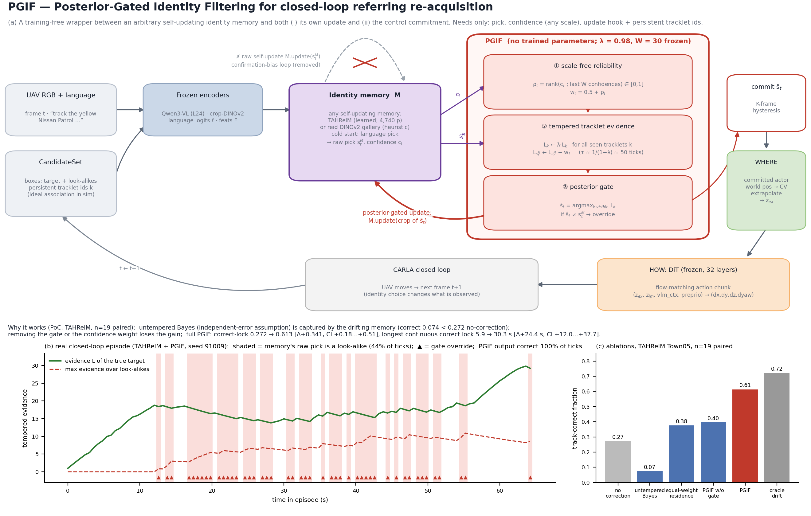
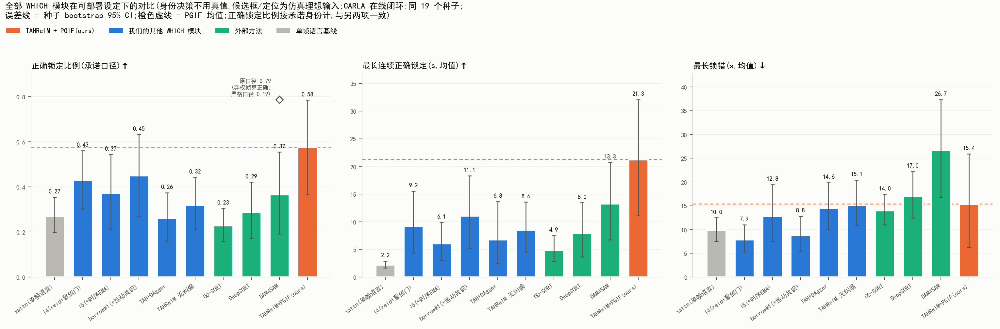

# 1001 · 创新点设计报告(终版 v4):PGIF — 后验门控身份滤波

> 2026-10-01 · 目标 venue:NeurIPS/ICML/ICLR 方法向 · 状态:**PoC 闭环完成,Codex 第 4 轮评审 "NO MAJOR ISSUES"**(`1001_codex_review_r4.md`)
> **2026-10-06 整体修订**(依据 `1004_aa_noise.md`、`1004_s55_fairness_audit.md` §8、`1004_tahrelm_retrain_diag.md`、`1004_code_framework.md`):
> - **协议分两层**:§1–§5.4 与 §5.5a 是「可部署 v1」口径(模拟器理想持久 ID、候选不滤遮挡、语言头开局);**当前最终协议是 §5.5b 的部署设定 v2**(不依赖真值的跟踪器 ID、射线遮挡过滤、属性开局)。v1 口径下的数字不能与 v2 直接比较。
> - **最终模型数字改用三次重复均值**:10-03 单次运行的承诺正确 0.646、开局 19/19 是三次重复中最好的一次;三次均值为 **0.578**,开局 **49/57 = 86%**。同一种子的运行间 SD 约 0.20,n = 19 单次配对的最小可检出效应约 0.18。
> - **PGIF 的 claim 收窄**:v1 口径下 PGIF 增益显著(§5.1–5.3);v2 下 PGIF 自身增益不显著(+0.09 [−0.02, +0.21],未接属性开局时测得)。v2 下最大的单项增益来自属性开局。§0、§6、§8、§9 已同步修改。
> - **新增 §3.2**:按当前代码(`acot/runtime/` + `ours_final.yaml` + `sim_proxy_v2@1.yaml`)写出最终模型逐 tick 的实现。整理中发现并更正了三处与代码不符的表述：跟踪器实际用贪心匹配，不是匈牙利;承诺目标没有匹配框时不做匀速外推，沿用 EAR 航点;开局第 3 个 tick 由 TAHRelM 自己选车。
> - **新增 §5.5c(2×2 闭环实验，同日)**:跟踪器改用匈牙利后承诺正确 +0.085(主效应,p = 0.02);遮挡期间匀速外推只拉长最长连续正确(+3.3 s),承诺正确不变、最长锁错有变长趋势。建议当前模型改为「匈牙利 + 原 WHERE」(实验臂 `hung`),外推暂不并入。新架构图 `figs/fig_architecture_v2.png`。
> - 外部基线与消融在 v2 下**仍未重跑**:acot 运行时已就绪(与旧入口决策逐位一致),但重跑未授权执行。
> 配套:`1001_poc-closure.md`(claim→证据矩阵、闭合判据核对)· 审稿记录 `1001_codex_review_r{1..4}.md` · 记忆 `acot-uav-pgif-poc`
> **评价指标(2026-10-02 起)**:论文只用三个客观指标——**正确锁定比例**(↑)、**最长连续正确锁定时长**(↑)、**最长锁错时长**(↓)。成功率 SR 依赖人为设定的阈值(≥2s 承诺错锁即判失败),**不作为评价指标**,仅在附录 B 留作参考。
> 标注:**[M] 已测** · **[T] 理论/解释性模型** · **[L] 局限**。路径约定:`eval_out/` = `carla_uav_tracking/rollout/eval_out/`;日志在 `runs/asd/`。所有闭环臂:live CARLA、seeds 91000–19、STEPS 900、s2=6,同种子配对 bootstrap 95% CI(`asd_stats.py`)。

---

## 0. 一句话

**闭环指代跟踪中,自更新的身份记忆用自己的逐帧选择作伪标签更新自己——这是闭环版的确认偏差:单帧误选被写进记忆、下一帧再被自己确认,放大为持续错锁。PGIF 在任意身份记忆外层,对持久 tracklet 维护"按误差相关时间回火、以置信度秩加权"的身份证据,并让记忆更新与控制承诺都以证据 argmax 为门。无训练参数;只需记忆暴露"选择 + 置信度 + 更新钩子",并假设环境提供持久 tracklet 关联。**

> **适用范围(2026-10-06)**:上面的机理和 §5.1–5.4 的显著增益,都是在**理想持久 tracklet ID** 下测得的。换成不依赖真值的跟踪器 ID 和遮挡感知候选(部署设定 v2,§5.5b)后,PGIF 自身的增益降到不显著;当前最终系统的主要增益来自**属性开局**(开局锁对率约 86%)。PGIF 在 v2 下的作用仍需在新种子、多次重复下重新检验(§9)。



*图 1 · (a) PGIF 位于身份记忆与(i)记忆自身更新、(ii)控制承诺之间,切断"原始自更新"这条确认偏差回路;(b) 一个真实闭环 episode(TAHRelM + PGIF,seed 91009):记忆原始选择 44% 的 tick 指向 look-alike(阴影),回火证据始终保持真目标领先,门控改写 47 次(▲),PGIF 输出 100% 正确;(c) 组成部分消融。源 `figs/fig_pgif_architecture.py`(b 面板由 `runs/asd/tah_tempered_91000.jsonl` 重放生成)。*

---

## 1. 问题:deployable 身份的断点

| 设定(TAHRelM 记忆,Town05) | 正确锁定比例 ↑ | 最长锁错 ↓(均值) | 来源 |
|---|---|---|---|
| oracle 记忆(每帧 GT crop 喂记忆,**非 deployable 上界**) | 0.746 | 1.9s | `paper_ext_tahrelm_gt` |
| GT 漂移检测上界(GT 判错 → 重置) | 0.721 | 1.9s | `paper_ext_tahrelm_oracledrift` |
| **deployable 无纠偏**(committed 记忆 + 语言冷启动) | **0.272** | 15.7s | `paper_asd_tah_observe` |
| 低置信语言重锚 | 0.263 | 13.3s | `paper_ext_tahrelm_deploy` |
| 冻结外观锚重锚(连续 3 tick 分歧) | 0.303 | 12.2s | `paper_asd_tah_anchor_p3` |

→ 漂移纠正是 deployable 的主杠杆(GT 检测即可收回大部分差距),但所有 GT-free 修补均无显著效果 **[M]**。

## 2. 诊断:为什么旧修补失败、信号在哪里

observe 模式(只记录不干预)日志,GT 仅用于离线打分:

| # | 发现 | TAH | reid | 含义 |
|---|---|---|---|---|
| D1 | 记忆自置信检测"当前选择≠目标"的 AUROC | 0.710 [0.546,0.811](30 ep) | 0.819 [0.792,0.862](8 ep) | 自置信**弱但有信息**,不是不可辨识 |
| D2 | 错锁时刻,参考指认真目标的命中率 | 冻结外观锚 0.25 · 语言 EMA 0.28 · 融合 0.27(随机 0.32) | 0.10 · 0.39 · 0.11(随机 0.36) | 外观/语言参考在 look-alike 漂移时刻**≈随机** → 锚/语言重锚必然失败 |
| D2' | 冻结外观锚相异度的 AUROC | 0.501 [0.421,0.622] | — | 同上 |
| D3 | 错锁时刻,tracklet 历史指认真目标 | 历史驻留 0.45 · 上一稳定身份 0.44 | 1.00 · 0.97 | **漂移免疫信号在 tracklet 持续性**;右→错切换时真目标仍可见 85–92% |
| D4 | 确认偏差机制 | 记忆逐帧用自身选择更新:错 tick 0.52,episode 末吸收于错锁 1/4–2/3 | gallery 只存 committed 身份(自带一层门控):错锁平均 2.9 tick | 自更新使误差**自相关** |

数据:`eval_out/auroc_{tah,reid}_observe.json`,`runs/asd/partial1/`。

## 3. 方法:PGIF

**接口**:记忆每 tick 给出选择 s^M_t、置信度 c_t(任意尺度)、更新钩子 `update(slot)`;环境提供持久 tracklet id(v1 口径下为模拟器理想关联,§5.4 给出非理想关联敏感度;部署设定 v2 改用不依赖真值的跟踪器 `rollout/tracklets.py`,并为目标不可见的情形加入 absent-hold,`absent_max=8`,见 §5.5b)。

```
状态:每个已见 tracklet k 的证据 L_k;最近 W 个置信度的窗口 H
每个决策 tick t:
  ① ρ_t ← rank(c_t ; H) ∈ [0,1],  w_t ← 0.5 + ρ_t        # 尺度无关:不同记忆无需标定
  ② L_k ← λ·L_k  (所有 k);  L_{s^M_t} ← L_{s^M_t} + w_t   # 回火:有效记忆长度 τ ≈ 1/(1−λ)
  ③ ŝ_t ← argmax_{可见 k} L_k
     若 ŝ_t ≠ s^M_t:  M.update(crop of ŝ_t) 取代 M.update(crop of s^M_t)   # 后验门控更新
                      控制承诺 ŝ_t                                         # 后验门控承诺
```
- 超参 λ=0.98(τ≈50 tick≈30s)、W=30:实现时先验默认值,**未在评测种子上调**;TAH、reid、Town10HD 同一组。
- 实现:`carla_uav_tracking/rollout/asd.py::ASD._filter_step`(`mode="filter", filter_kind="tempered"`),`policy.py::_asd_gate_memory`;启动 `rollout/eval_asd.sh`。

### 3.1 可训练模块与参数量

**PGIF 本身没有任何可训练参数(0 个)**:它是一个纯推理期的递推规则,只有两个**人工设定、冻结**的超参(λ=0.98、W=30),既不训练也没有在评测种子上调。下表是 PGIF 包裹的整个 deployable 系统的参数构成(由 ckpt 实测计数):

| 模块 | 作用 | 参数量 | 是否可训练 / 本轮是否更新 |
|---|---|---|---|
| **PGIF**(`asd.py::_filter_step`) | 回火证据累积 + 后验门控 | **0**(超参 λ、W 各 1 个,冻结) | 无可训练参数 |
| TAHRelM(`train/tah.py::TAHRelM`,`runs/tah_relm_dag.pt`) | 被包裹的身份记忆:7 个相对特征 → MLP 7·64·64·1 + 3 个可学门(gate/vbeta/mgate) | **4,740** | 可训练(此前已用 offline + DAgger 训练);**本轮冻结,未重训** |
| Qwen3-VL-4B(第 24 层特征) | 语言条件视觉特征、冷启动语言 grounding | ~4B | 冻结 |
| crop-DINOv2 ViT-S/14 | 候选外观特征 | ~22M | 冻结 |
| Stage-2 TargetIDHead(xattn,`stage2_best.pt`) | 冷启动语言选车 logits(v1 口径的开局) | 2,296,577 | 冻结 |
| 属性开局 v1(`eval_out/opening_attr_ft.pt`) | v2 的开局:DINOv2 颜色 + 车型分类(17 类闭集),配 3× 高清开局帧 | 见 `1004_opening_fix.md` | 在独立种子 96000–96279 上训练,评测时冻结 |
| EAR / IAR | 隐式动作先验 z_im 等 | 5,071,107 / 972,866 | 冻结 |
| DiT(32 层 flow-matching) | 动作生成 | 136,778,757 | 冻结 |

→ 在 v1 口径下,整个系统中**唯一经过训练的身份相关参数是 TAHRelM 的 4,740 个**(v2 另加属性开局分类头),PGIF 在其外层**不新增任何参数、不需要任何训练数据**;换成启发式 reid gallery(本身 0 参数)时,整条身份链路完全无训练参数。

### 3.2 最终模型的实现(部署设定 v2;2026-10-06 按代码整理)

> 本节按当前代码写，取代上面伪代码中只适用于 v1 口径的部分(理想 ID、语言开局)。
> - **配置**:方法 `acot/configs/methods/ours_final.yaml`(继承 `_base.yaml`),协议 `acot/configs/protocols/sim_proxy_v2@1.yaml`(冻结;任何改动都要新建版本文件)。
> - **运行时**:`acot/runtime/`。`perception.py` 提供候选,`frontend.py` 提供 VLM、Stage-2 与开局,`heads.py` 是身份记忆,`pgif.py` 是滤波器,`policy.py` 串起每个 tick 的决策。
> - **与旧代码的关系**:acot 运行时是 `carla_uav_tracking/rollout/policy.py::Policy.act` 的逐行移植，按相同顺序、相同 RNG 调用执行;旧入口仍可用(`infra.runtime=legacy`)。
> - **等价性验证**:
>   - 在录制的 act 消息上回放，决策完全一致(`acot/eval/replay_parity.py` → `eval_out/exp/p2_parity/`:种子 91000 上 402 个动作 0 处不一致，`ours` 与 `no_pgif` 两臂都通过;另有 91001、93000 以及 DAM4SAM 臂);
>   - 闭环 A/A 与旧入口无系统差异(`1004_aa_noise.md`)。

**每个 S2 tick(0.6 s)的决策流程**(DiT 动作每步 0.1 s 生成一次)

1. **感知(仿真替身,`SimProxyPerception.process`)**
   - 候选：场景指定车辆(目标 + 干扰车)中在画面内的，按真值位置投影成伪框(车长按 4 m 计，框边 10–140 px),再用每集固定种子的 RNG 打乱顺序。背景车流不进候选。
   - 遮挡：环境做射线检测，被遮挡的车整框丢掉，目标与干扰车用同一规则。
   - 外观:crop-DINOv2 ViT-S/14(224 px,裁剪放大 1.3 倍),特征 L2 归一化。
   - **跟踪器 ID**(`rollout/tracklets.py::TrackletAssigner`,不读真值):
     - 代价 = 0.15·(距离 / 门限)+ 0.85·(1 − 外观余弦),门限 = max(150 px, 2 × 框边);超出门限或余弦 < 0.2 的配对禁止;
     - 每条轨迹在图像平面上做匀速预测(速度 EMA β = 0.5),外观 EMA α = 0.3;
     - 连续 8 个 tick(4.8 s)没匹配到就删除轨迹，没匹配上的框分配新 ID。所以遮挡超过 4.8 s 的车回来时会换新 ID;
     - **分配用贪心(按代价升序),不是匈牙利**:旧的 deploy-v2 运行镜像里没有 scipy,`TrackletAssigner` 一直退回贪心;acot 运行时默认固定为贪心，保持一致。
     - **新开关(10-06)** `perception.tracker.assign: hungarian`(只能通过感知消融项覆盖，冻结的协议文件未改):使用 numpy 实现的匈牙利求解器 `acot/runtime/lsa.py`。跟踪器参数本来就是在匈牙利下调的;闭环效果见 §5.5c(承诺正确 +0.085),**建议采用**。
   - 每个候选附带它所投影车辆的**仿真真值世界坐标**,供 WHERE 使用。
2. **前端(冻结)**:Qwen3-VL-4B 编码当前帧与指令(`language_mode: neutral`)。EAR 用 flow-matching 采样航点先验 z_ex,IAR 给出隐式先验 z_im;Stage-2 grounding 头算出每个候选的语言 logits。
3. **属性开局**(前 3 个 S2 tick,即 0 / 0.6 / 1.2 s;`rollout/opening_zoom.py::AttrScorer`)
   - 输入是同位姿、同 FOV 的 3× 分辨率第二相机画面(只在开局 tick 渲染)。
   - 从指令中解析出颜色词和车型词。每个候选的得分 = log p(车型 = 指令车型)+ log p(颜色 = 指令颜色);每一项是线性头与微调头各占 0.5 的混合:
     - 线性头：输入为多尺度 + 翻转的 DINOv2 特征，颜色项另拼接颜色直方图;
     - 微调头：微调过的 DINOv2,配翻转 TTA;
     - 不用 Qwen 的颜色问答(`wq = 0`)。
   - 每个 tick 的得分先减去当 tick 的最大值，再按跟踪器 ID 跨 3 个 tick 累加，取 argmax 作为开局选择。
   - 与记忆的交互(`final_reset: false`、`force_final: false`):
     - 前两个开局 tick,每次打分后都清空 TAHRelM 记忆，记忆为空，所以本 tick 采用当前累计的开局选择并写入;
     - 第 3 个 tick 不再清空，记忆里是第 2 个 tick 的开局选择，**由 TAHRelM 自己选车**。3 个 tick 的累计开局分只记录在日志中，不强制采用;
     - 代码注释写的是「由最终开局选择初始化记忆」,与这组设置下的实际行为不符。
   - PGIF 在开局期间不重置、不预置。
4. **身份记忆 TAHRelM**(`heads.py::TahHead`,`runs/tah_relm_dag.pt`,4,740 参数)
   - 输入每个候选的 crop 特征和 (u/W, v/H, 深度/100),输出 logits;记忆为空时直接采用开局选择。
   - 先按本 tick 的选择写入记忆，同时保存写入前的快照，供 PGIF 改写或撤销。
5. **置信度** = logits 的 top1 − top2 差值。TAHRelM 自身学到的置信度会被这个差值覆盖(与旧代码一致)。
6. **PGIF**(`pgif.py`,tempered + absent-hold)
   - 证据更新：秩 = 当前置信度在最近 30 个置信度中的分位(历史少于 5 个时取 0.5);所有 ID 的证据先乘 λ = 0.98,再给本 tick 的选择加 0.5 + 秩。
   - **absent-hold**:最近 8 个 tick 内出现过的 ID 都算「存活」。如果证据最高的存活 ID 本 tick 不可见，且证据高于所有可见 ID,就输出「目标不在」:本 tick 不选车，置信度置 0,撤销记忆写入，承诺保持不变。
   - **门控**:否则取可见 ID 中证据最高者。若与记忆的选择不同，就从快照出发、用它重做记忆更新，选择改为它，**直接承诺(跳过滞回)**,置信度置 1。
7. **承诺**:只有置信度 ≥ `conf_tau` = 0.5 时才更新承诺;挑战者需连续 K = 5 个 tick 被选中才能取代当前承诺。
8. **WHERE**:
   - 承诺 ID 本 tick 有匹配框时，取该车的真值世界坐标。若置信度够、且该点在画面内，就更新匀速目标估计器;只要估计器初始化过，就用它外推出的航点替换 z_ex。
   - **承诺 ID 本 tick 没有匹配框时(被遮挡、出画或 absent-hold),z_ex 保持 EAR 自己采样的航点，不做匀速外推。** 旧代码注释写的是「估计器按匀速滑行」,但实际代码在这种情况下不覆盖 z_ex;acot 运行时与旧代码逐位一致，也是如此。§5.5b 中「目标不可见时匀速滑行」的表述据此更正。
   - **新开关(10-06)** `control.absent_where: cv`(方法 `ours_absent_cv`):承诺 ID 没有匹配框且估计器已初始化时，用估计器从最后一次确信的位置匀速外推出航点，替换 z_ex。闭环效果见 §5.5c:最长连续正确 +3.3 s,但承诺正确不变、最长锁错有变长趋势，**暂不并入**。
   - 两个新开关都只在 acot 运行时实现;旧运行时遇到它们会拒绝运行(`acot/config/legacy.py::hardcoded_problems`),不会静默忽略。
9. **动作**:32 层 DiT 每步(10 Hz)由 z_ex、z_im、语言上下文和本体状态生成 (dx, dy, dz, dyaw) 与搜索标志;`frame_gain = 0`,不额外加居中修正。

**协议声明的特权感知**(`privileged_perception`,对所有臂相同):候选框由真值投影得到、候选深度为真值、遮挡由射线检测真值判定、候选集只含场景指定车辆、WHERE 使用匹配框的真值世界坐标。身份决策链路(跟踪器 ID、开局、TAHRelM、PGIF、承诺)不读标签;`acot/runtime/audit.py` 在运行时审计真值访问。

**已配置、尚未运行的对照臂**(`acot/configs/methods/`):`ours_no_pgif`、`ours_no_absent`、`ours_pgif_bayes`、`diag_oracle_absent`,外部基线 `ext_dam4sam`、`ext_assoc_deepsort`、`ext_assoc_motion`、`lang_xattn`;所有臂共享协议里的属性开局前端。

**运行**:`python -m acot eval acot/configs/experiments/<x>.yaml --workers N --carla-ports … --gpus …`;冒烟实验为 `smoke_ours_final.yaml`(dev 91000–91001),配置差异用 `python -m acot show <exp> --arm ours --diff` 查看。

## 4. 理论

**命题 1(闭环确认偏差 → 近似吸收;受限)[T]**:两个外观对称的 look-alike、EMA 自更新、无外部信号时,一旦误选,记忆以几何速率收敛到错误实例,此后每步回到目标的概率 ≤ exp(−δ²/cσ²)(δ 为外观间隙);且自置信在对称不动点处对"锁对/锁错"同分布。Toy 验证 **[M]** `eval_out/toy_drift.json`:错锁占比 0.27,连续 5 tick 错后回到目标仅 0.60。*边界*:真实系统有运动/历史等破坏对称的信号,故实测自置信 AUROC 为 0.71/0.82(D1)而非 0.5;命题只说明自更新使误差持续(自相关)。

**命题 2(解释性模型:相关误差下的证据回火)[T]**:设 (B1) 记忆选择指向目标的概率 >1/2,且秩置信度对正确性 AUROC>0.5(D1 满足);(B2') 误选指示序列平稳、相关时间为 τ(自更新使 τ≫1);(B3) 真身份切换稀少。模型给出三条**可检验预测**:
- (a) 把每 tick 当独立证据相乘会把有效证据高估约 τ 倍,一段长度 ~τ 的相关误选即可翻转后验 → **未回火滤波会被俘获,甚至差于不纠偏**;
- (b) 以 λ≈1−1/τ 回火的置信加权累积,有效样本量约 T/τ,只有错误持续显著超过 τ 才翻转 → **回火 + 置信加权 > 等权驻留**;
- (c) 门控阻止误选写入记忆,预期降低误差相关时间 → **门控 > 只改承诺不门控**。

*地位*:解释性模型,非闭环严格界(闭环改变观测分布);(c) 未直接测 τ,仅由消融间接支持。三条预测的闭环检验见 §5.2,**全部成立**。

## 5. PoC 结果

> **读本节前(2026-10-06)**:§5.1–5.4 与 §5.5a 都在「可部署 v1」口径下测得(理想持久 ID、候选不滤遮挡、语言头开局),而且每个臂只跑了一次。按 `1004_aa_noise.md` 的噪声底,单次 n = 19 配对只能可靠检出约 0.18 的承诺正确差。§5.1 的 +0.341 远超这个量级,结论稳健;§5.3 中单设定 +0.10 量级的差无法单独判断。当前最终协议与模型见 §5.5b。

### 评测设定(离线 / 在线 gt-seeded / 在线 deployable)

| 设定 | 在哪里跑 | 身份记忆用什么更新 | 控制闭环 | 用途 |
|---|---|---|---|---|
| **离线** | 已采集数据(`runs/tah_cache.pt` 64 ep + DAgger 23 ep) | 训练时用 GT 身份(teacher forcing) | 否(逐帧打分,不飞行) | 训练/验证 TAHRelM(val 0.990);PGIF 开环回放分析(§5.4) |
| **gt-seeded(oracle 记忆)** | **CARLA 在线闭环** | **每个决策步用 GT 目标的 crop/位置更新** | 是 | 上界:记忆永不漂移 |
| **deployable** | **CARLA 在线闭环** | **用模型自己的承诺身份更新**;冷启动用语言选车 | 是 | 部署条件下的身份表现:身份决策不用 GT(候选框与车辆定位仍为仿真理想输入) |

实现:`policy.py --gallery-seed {gt, committed}`。TAHRelM 记忆更新源 `us = true_idx if gallery_seed != "committed" else _pred_slot`(`policy.py:636`);reid gallery 同理(`policy.py:299`);committed 模式冷启动用语言 grounding(`policy.py:594` 起)。两种在线设定的闭环、因果性(只用过去信息)与打分完全相同,GT 只在环境侧用于打分;区别仅在于 gt-seeded 额外把 GT 喂给身份记忆。gt-seeded 下 PGIF 只门控控制承诺(记忆按定义仍由 GT 更新,`policy.py:709`)。

### 指标口径(三项客观指标)
| 指标 | 定义 | 来源 / 分辨率 |
|---|---|---|
| **正确锁定比例** ↑ | 目标在画面内的帧中,**承诺身份**(K=5 滞回)为真目标的帧比例;模型弃权(本帧不给任何选择)时沿用上一承诺——与另两项指标同一"锁定"定义 | scorer,逐帧 10 Hz(1 − `mis_follow_sustained`)。**2026-10-02 口径修正**见下方说明 |
| **最长连续正确锁定时长** ↑ | 每个 episode 内连续锁定真目标的最长时长;目标出画即断开(偏保守) | 本轮各臂由决策 tick 日志计算(1 tick = 0.6s,经步数对齐到种子,`rollout/tick_align.py`);scorer 已新增逐帧字段 `max_correct_run_s`,此后实验直接记录 |
| **最长锁错时长** ↓ | 每个 episode 内承诺身份(K=5 滞回)持续为错误车辆的最长时长 | scorer,逐帧(`max_wrong_run_s`) |

> **口径修正(2026-10-02)**:此前正确锁定比例取 1 − `mis_follow_inst`,scorer 只把"选了错车"记为错,**弃权帧被计为正确**。会弃权的只有 DAM4SAM(SAM2 掩码为空或 160 px 关联门内无候选,约占目标在画面帧的 60%),其余各臂每帧都给出选择,三种口径相差 ≤ 0.01。DAM4SAM:原口径 0.786 → 承诺口径 0.367 → 严格口径(弃权算错)0.190。这一修正发生在看到 DAM4SAM 的弃权现象之后,属于**结果后修正**:主口径改为承诺口径,因为它与最长连续正确/最长锁错是同一"锁定"定义;1003 的预注册判定仍只按原口径(见 `1003_iteration_roadmap.md`)。三种口径同时报告:§5.5 图中 ◇ 标出原口径值,全部数字见 `eval_out/deploy_compare.json`(`correct_l` / `correct_s`)与 `rollout/iter_gate.py`。细节:episode 开头尚无承诺时的弃权帧在承诺口径下不计为错,对所有臂同样偏宽。

一致性校验:tick 日志算出的正确比例与 scorer 逐帧值相关 r = 0.998–1.000;最长锁错 r = 0.87–0.99(差异来自 scorer 用滞回后的承诺身份)。全部数字:`rollout/pgif_three_metrics.py` → `eval_out/pgif_three_metrics.json`;配对 bootstrap 95% CI。

### 5.1 主结果(TAHRelM,Town05,n=19 同种子配对)

| 臂 | 正确锁定比例 ↑ | 最长连续正确锁定 ↑(均值 / 中位) | 最长锁错 ↓(均值 / 中位) |
|---|---|---|---|
| 无纠偏 | 0.272 | 5.9s / 1.8s | 15.7s / 11.6s |
| **PGIF** | **0.613** | **30.3s / 21.0s** | 10.8s / **0.8s** |
| 相对无纠偏 Δ [95% CI] | **+0.341 [+0.177,+0.512]** | **+24.4s [+12.0,+37.7]** | −5.0s [−14.0,+5.1](不显著) |
| GT 漂移检测上界(参照) | 0.721 | 未记录 | 1.9s / 2.2s |

- 正确锁定比例与最长连续正确锁定均**显著**提升;PGIF 收回 GT 漂移检测上界在正确锁定比例上增益的 **76%**(0.341/0.449),且完全 GT-free **[M]**。
- 最长锁错:中位数 11.6s→0.8s(多数 episode 已无长时间锁错),但均值的下降**不显著**——长尾来自冷启动即锁错的 episode(见下)。
- 门控行为:改写占 tick 20%;改写中 65% 把选择拉到真目标、11% 拉离 **[M]**。

**冷启动分层(2026-10-02 更正)**:按各臂日志中首个可标注 tick 是否锁定真目标分层。此前版本的 tick 日志与种子错位(跳过的 episode 不触发策略 reset),曾错误得出"冷启动锁错子集也提升 0.365→0.521";按步数对齐后的正确结果:

| 设定 | 初始锁定正确:正确锁定比例(无纠偏→PGIF,Δ [CI]) | 初始锁定错误:正确锁定比例(Δ [CI]) |
|---|---|---|
| Town05·TAHRelM | n=12:0.383→**0.961**,**+0.578 [+0.433,+0.724]** | n=7:0.082→0.017,−0.065 [−0.127,−0.011] |
| Town10HD·TAHRelM | n=9:0.485→**0.899**,**+0.414 [+0.229,+0.597]** | n=11:0.250→0.094,−0.156 [−0.355,+0.056] |
| Town05·reid | n=12:0.545→**0.802**,**+0.257 [+0.085,+0.443]** | n=7:0.152→0.008,−0.144 [−0.183,−0.108] |

→ **初始锁定正确时,PGIF 几乎消除了后续漂移**(三个设定均显著);**初始锁定错误时,PGIF 会忠实地坚持错误身份**,略有恶化——这正是持续性机制的反面。PGIF 的整体增益上限由冷启动(语言初锁)正确率决定,这是下一步最重要的改进方向 **[M]**。(后续:属性开局 v1 已针对这一点,v2 下开局锁对率从 8/19 提高到三次重复平均 86%,见 §5.5b。)

### 5.2 组成部分消融 = 命题 2 的三条预测(Town05,n=19 配对)

| 变体 | 正确锁定比例 | 最长连续正确锁定(均值) | 最长锁错(均值) | **PGIF − 变体**:正确比例 / 最长正确 / 最长锁错 [CI] | 预测 |
|---|---|---|---|---|---|
| 未回火贝叶斯滤波 | **0.074** | 2.9s | 26.9s | +0.540 [+0.309,+0.752] / +27.3s [+12.0,+43.6] / −16.1s [−24.8,−8.0] | (a) ✅ |
| 等权驻留(无置信加权) | 0.376 | 19.5s | 17.0s | +0.237 [+0.058,+0.425] / +10.7s [−2.3,+23.2] / −6.2s [−12.2,−1.0] | (b) ✅ |
| PGIF 去门控 | 0.396 | 14.7s | 20.0s | +0.217 [+0.034,+0.401] / +15.6s [−0.9,+31.9] / −9.3s [−17.8,−1.3] | (c) ✅ |
| **PGIF** | **0.613** | **30.3s** | **10.8s** | — | — |

→ PGIF 对三个变体在正确锁定比例与最长锁错上均显著更好;最长连续正确锁定对等权驻留与去门控的差为正但 CI 略含 0。未回火贝叶斯在三项指标上都比不纠偏更差(正确比例 Δ−0.198 [−0.338,−0.076],最长锁错 +11.1s [+2.6,+20.5]),直接印证"自更新使误差自相关" **[M]**。

### 5.3 泛化(同一冻结超参)

| 设定 | n | 正确锁定比例(基线→PGIF,Δ [CI]) | 最长连续正确锁定(均值,Δ [CI]) | 最长锁错(均值,Δ [CI]) |
|---|---|---|---|---|
| TAHRelM · Town05(主) | 19 | 0.272→0.613,**+0.341 [+0.177,+0.512]** | 5.9→30.3s,**+24.4s [+12.0,+37.7]** | 15.7→10.8s,−5.0s [−14.0,+5.1] |
| TAHRelM · **Town10HD**(跨场景) | 20 | 0.356→0.456,+0.100 [−0.087,+0.287] | 12.7→21.4s,+8.7s [−4.4,+22.0] | 16.3→16.1s,−0.2s [−7.9,+8.1] |
| **reid gallery**(跨记忆)· Town05 | 19 | 0.400→0.510,+0.110 [−0.025,+0.262] | 9.7→19.1s,+9.4s [−1.7,+22.5] | 11.4→12.1s,+0.7s [−5.6,+7.8] |
| 三设定合并(分层配对 bootstrap) | 58 | **+0.182 [+0.086,+0.280]** | **+14.1s [+7.0,+21.6]** | −1.5s [−6.0,+3.3] |

- **稳健结论**:合并 58 个 episode 时,正确锁定比例与最长连续正确锁定**均显著**提升;单设定中仅 Town05·TAHRelM 显著。最长锁错在各设定均**未显著改善**——由冷启动锁错 episode 主导(§5.1 分层)。
- 跨场景/跨记忆增益较小的主要原因是冷启动锁错比例更高(Town10HD 20 个中 11 个);reid 另有"gallery 只存 committed 身份 = 自带一层门控"的原因(D4)。
- reid 基线为同会话重跑(与 9 月 `reid_deploy` 一致:正确比例 Δ−0.016 [−0.099,+0.057])。

### 5.4 对 tracklet 关联噪声的敏感度(开环回放,30 个 TAH observe episode,`eval_out/pgif_idnoise_tah.json`)

| ID 碎片化/互换率 p(每 tick,tick=0.6s) | 0 | 0.005 | 0.01 | 0.02 | 0.05 | 0.1 |
|---|---|---|---|---|---|---|
| 记忆原始选择 | 0.332 | 0.332 | 0.332 | 0.332 | 0.332 | 0.332 |
| PGIF(开环,无门控反馈) | 0.402 | 0.391 | 0.385 | 0.384 | 0.354 | 0.339 |
| 增益 | +7.0pp | +5.9 | +5.3 | +5.2 | +2.2 | +0.7 |

→ p≤0.02/tick(每目标约每 30s 至多一次关联错误)保留约 3/4 增益;p=0.1 时基本消失。PGIF 需要中等质量的持久关联层 **[M][L]**。开环回放中回火与等权驻留持平(0.402 vs 0.407),二者闭环差异(§5.2)来自门控对后续观测的反馈,开环无法体现。

### 5.5 全部 WHICH 模块在可部署设定下的对比(2026-10-02 首版;2026-10-04 评测协议升级为部署设定 v2 + 属性开局;2026-10-06 按 A/A 重复修订)

> **状态(2026-10-06)**
> - **5.5a**(下文原表)是在「可部署 v1」口径下得到的：身份决策不使用真值，但候选带仿真理想的持久 tracklet ID,不考虑遮挡，开局用语言 grounding 头。按现在的标准，这个口径偏宽松：同一模型只要换成遮挡感知候选，承诺正确就从 0.576 降到 0.365。
> - **当前最终协议见 5.5b**:不依赖真值的跟踪器 ID、射线遮挡过滤候选、WHERE 只用本 tick 匹配到的框、PGIF 不可见假设(absent-hold)、属性开局 v1。
> - **最终模型的数字以三次重复均值为准**(10-03 原始运行 + 10-04 的 acot 重跑和旧入口重跑):承诺正确 0.578、开局 86%。原先报告的 0.646、19/19 是三次中最好的一次(`1004_aa_noise.md`)。
> - **5.5a 中所有外部基线都是在 v1 口径下跑的**(日志中均无 `--occl-cands`),不能与 5.5b 的数字直接比较。基线需要在最终协议下、共享同一开局模块重跑，已列入 1004 的 T0 和 test。截至 10-06,acot 运行时已完成(新旧入口决策逐位一致，`eval_out/exp/p2_parity`;两者 A/A 无系统差异),但**基线与消融的重跑尚未执行**(`1004_code_framework.md` §21)。

#### 5.5a 可部署 v1 口径下的对比(2026-10-02;协议已被 5.5b 取代，保留作历史记录)

> **"deployable"的确切含义(措辞更正,2026-10-02)**:指**身份决策链路不使用真值**——不告诉模型哪辆是目标,身份记忆/轨迹状态/初始化只来自模型自己的选择(冷启动用语言)。但以下两项仍由仿真理想提供,对所有臂相同:① 候选框(由真值车辆位置投影 = 理想检测器 + 理想持久关联,`candidates.py::build_candidates`);② WHERE 使用被承诺车辆的世界坐标(`policy.py::_committed_world`)。因此此前"决策时不使用任何真值"的表述过强,应为"身份决策不使用真值,感知与定位假设理想"。
> **为什么重跑**:旧版对比(`907_baseline_compare_906.md` 图 1,2026-09-06)中的 8 个方法都运行在 **gt-seeded** 设定——身份记忆/轨迹状态每一步用真值目标刷新,等于给模型一条作弊通道,不能作为方法比较。本节所有臂(含外部 baseline)均为 **deployable**:冷启动用语言选车,之后只用模型自己的承诺身份更新记忆;CARLA 在线闭环,同种子 91000–19(19 个计分 episode),三项指标由新版 scorer 逐帧记录(`max_correct_run_s` 与 `max_wrong_run_s` 均以承诺身份为准,目标出画即断开)。外部方法的可部署化:OC-SORT/DeepSORT 轨迹状态改为用自己关联到的车更新,DAM4SAM 改为用语言选中车辆的框初始化(`policy.py` `_assoc_select` / `_dam4sam_select` 的 `init_slot`)。批量脚本 `runs/asd/deploy_all/chains.sh`;统计 `rollout/deploy_compare.py` → `eval_out/deploy_compare.json`。



*图 2(可部署 v1 口径，已被 5.5b 取代)· 全部模块在可部署设定下的三项指标(误差线 = 种子 bootstrap 95% CI;橙色虚线 = PGIF 均值;正确锁定比例为承诺口径,◇ = DAM4SAM 的原口径值,其弃权帧被计为正确)。源 `figs/fig_deploy_compare.py`。*

| 方法 | 类别 | 正确锁定比例(承诺)↑ [95% CI] | 最长连续正确锁定 ↑(均值 / 中位,s) | 最长锁错 ↓(均值 / 中位,s) | **PGIF − 该方法**(配对 Δ [95% CI]):正确比例 / 最长正确 / 最长锁错 |
|---|---|---|---|---|---|
| xattn(单帧语言) | 语言基线 | 0.271 [0.20, 0.35] | 2.2 / 1.8 | 10.0 / 9.8 | +0.30 [+0.12, +0.48] / +19.01 [+9.27, +29.62] / +5.44 [-3.07, +14.80] |
| l4(reid+置信门) | 我们的 | 0.429 [0.30, 0.56] | 9.2 / 2.8 | 7.9 / 5.7 | +0.15 [-0.02, +0.31] / +12.04 [+4.69, +20.21] / +7.50 [-0.53, +16.74] |
| l5(+时序EMA) | 我们的 | 0.372 [0.21, 0.54] | 6.1 / 2.4 | 12.8 / 9.6 | +0.20 [+0.04, +0.39] / +15.19 [+6.83, +24.86] / +2.58 [-4.89, +10.59] |
| borrow#1(+运动共识) | 我们的 | 0.450 [0.27, 0.63] | 11.1 / 3.2 | 8.8 / 8.2 | +0.13 [+0.00, +0.27] / +10.18 [+3.71, +18.04] / +6.61 [-0.61, +14.51] |
| TAH+DAgger | 我们的 | 0.261 [0.16, 0.37] | 6.8 / 2.4 | 14.6 / 9.3 | +0.32 [+0.15, +0.49] / +14.47 [+6.44, +23.52] / +0.87 [-6.56, +9.13] |
| TAHRelM 无纠偏 | 我们的 | 0.320 [0.21, 0.44] | 8.6 / 5.2 | 15.1 / 13.1 | +0.26 [+0.08, +0.43] / +12.68 [+3.29, +23.44] / +0.29 [-7.47, +9.35] |
| OC-SORT | 外部 | 0.229 [0.16, 0.31] | 4.9 / 3.6 | 14.0 / 12.5 | +0.35 [+0.15, +0.54] / +16.38 [+7.06, +26.35] / +1.38 [-8.16, +12.08] |
| DeepSORT | 外部 | 0.286 [0.17, 0.42] | 8.0 / 4.2 | 17.0 / 12.7 | +0.29 [+0.09, +0.50] / +13.29 [+2.52, +24.43] / -1.60 [-10.62, +8.42] |
| DAM4SAM | 外部 | 0.367 [0.19, 0.55] | 13.3 / 6.4 | 26.7 / 21.6 | +0.21 [-0.00, +0.41] / +7.97 [-2.28, +18.43] / -11.26 [-23.19, +0.65] |
| **TAHRelM+PGIF(ours)** | **ours** | 0.576 [0.37, 0.78] | 21.3 / 11.5 | 15.4 / 0.9 | — |

> **公平性审计(2026-10-03,`1004_s55_fairness_audit.md`,Claude 自查 + codex 复查)**:**未发现作弊**,决策链路没有读取真值。但本节**不是同等接口、同等工程预算下的公平比较**:
> - PGIF 使用了模拟器的理想持久 tracklet ID,外部基线没有用;
> - 我们的方法在这 19 个开发种子上反复开发和选型,外部基线未调参(`conf_tau` 0.5 对 0.05),PGIF 触发时强制置信为 1;
> - DAM4SAM 作为视频跟踪器只每 0.6 s 更新一次(可能对它不利);
> - 6 个臂各有 1 集因仿真超时截断但仍被计分(剔除后方向不变);
> - 正确比例口径是结果后修正的。
>
> 因此下列结论均为**暂定**:相对 TAHRelM 无纠偏和若干未调参基线,正确锁定比例与最长连续正确锁定更高;**相对 DAM4SAM 的优势处于边界或不显著**。正式结论以 `1004_ablation_design.md` 预注册实验(全新 test 种子)为准。

**读法(如实,承诺口径)**:
- **PGIF vs 我们的其他模块与 OC-SORT/DeepSORT**:正确锁定比例与最长连续正确锁定上,PGIF 对 xattn、l5、TAH+DAgger、TAHRelM 无纠偏、OC-SORT、DeepSORT 均**显著更好**(CI 不含 0);对 borrow#1 正确比例 +0.13 [+0.00, +0.27]、对 l4 +0.15 [−0.02, +0.31] 处于显著边界,最长连续正确均显著更好。**最长锁错上 PGIF 与它们都无显著差异**,l4(7.9s)、borrow#1(8.8s)的均值低于 PGIF(15.4s)——PGIF 的中位数仅 0.9s,均值被少数冷启动锁错的长尾拉高。
- **DAM4SAM(外部 SOTA,SAM2-L 记忆)**:三项指标上 PGIF 方向均更好——正确锁定比例 +0.21 [−0.00, +0.41](边界)、最长连续正确 +8.0s [−2.3, +18.4]、最长锁错 −11.3s [−23.2, +0.7](均不显著)。DAM4SAM 的最长锁错均值 26.7s、中位 21.6s,为所有方法中最长——"粘滞记忆":锁错后长期不改。**此前"DAM4SAM 正确比例显著高于 PGIF(0.786 vs 0.583)"的结论来自旧口径把 DAM4SAM 的弃权帧(约 60%)算作正确,已撤回**;严格口径(弃权算错)下 PGIF 显著更好(+0.39 [+0.16, +0.61])。仍不声称"全面显著优于",n=19 下只有严格口径达到显著。
- **作弊设定严重高估了外部方法**:OC-SORT/DeepSORT 在 gt-seeded 下正确比例约 0.75,可部署下只有 0.23/0.29。
- **与 §5.1 的差异**:§5.1 中 PGIF 为 0.613,来自 10-01 的 PoC 批次(开局锁对 12/19);本节 0.576 来自 10-02 的同配置重跑(开局锁对 11/19)。两者差异属运行间方差,主要来自开局语言选择。
- 全部 10 个臂均已完成(20 episode,19 计分,0 报错)。重算:`rollout/deploy_compare.py` → `figs/fig_deploy_compare.py` → `figs/update_s55_table.py`。

**后续(1003 迭代,已完成)**:把 PGIF 包在 DAM4SAM 外层(V1)、异构记忆融合(V3)等版本的闭环结果、门控判定与泛化实验见 `1003_iteration_roadmap.md`。

#### 5.5b 部署设定 v2 + 属性开局(当前最终协议;2026-10-04;dev 91000–19,Town05,n = 19 同种子配对)

**协议**
- **身份决策不使用真值**:
  - 候选 ID 由不依赖真值的跟踪器分配(`rollout/tracklets.py`,运动 + crop-DINOv2 外观代价的贪心匹配，实际运行中从未用到匈牙利，见 §3.2;`TRK_CFG` 在 dev 回放上调参后冻结);
  - 候选按射线遮挡检测过滤，目标与干扰车用同一规则(`--occl-cands`、`VIS_RAYCAST=1`);
  - 开局由属性开局模块 v1 决定(`OPENING=attr`、`{"window":3,"ft":0.5}`、`HIRES=3`,见 `1004_opening_fix.md`);
  - PGIF 为 tempered + absent-hold(`absent_max=8`);TAHRelM 权重为 `runs/tah_relm_dag.pt`。
- **仍为理想化的感知输入(对所有臂相同，如实披露)**:
  1. 候选框是仿真检测替身：真值投影 + 真值深度，只会因遮挡漏检;而且**只包含目标和场景指定的干扰车，背景车流(`default.yaml` ambient 80 辆)不作为候选**;
  2. WHERE 用承诺 ID 本 tick 匹配到的框，取该车的**仿真真值世界坐标**(理想定位);承诺 ID 本 tick 没有匹配框时，不做匀速外推，沿用 EAR 自己采样的航点(§3.2 第 8 步;此前写作「匀速外推滑行」,与代码不符，已更正)。
  - 结构图:`figs/fig_architecture_v1.png`。

**从旧模型到最终模型的逐步演进**(同 19 个种子、同一套指标;`rollout/arch_compare.py`)

S1–S4 各只跑了一次。S5 有三次重复(同一配置):10-03 原始运行(`zoa_pgif_trk_*`)、10-04 旧入口重跑(`aa_legacy_*`)、10-04 acot 重跑(实验 `aa_noise`,跳过 91004)。下表与配对差只用三次都有的 19 个种子(91000–91019 去掉 91004)。

| 步骤 | 开局锁对 | 承诺正确 ↑ | 宽松 / 严格 | 最长连续正确 ↑ | 最长锁错 ↓ | 集长(步) |
|---|---|---|---|---|---|---|
| S1 旧模型 TAHRelM + PGIF(v1 口径 = 5.5a 的 ours) | 11/19 | 0.576 | 0.583 / 0.584 | 21.3 s | 15.4 s | 635 |
| S2 + 遮挡感知候选(理想 ID) | 8/19 | 0.365 | 0.415 / 0.436 | 4.5 s | 11.3 s | 423 |
| S3 + 调参后的跟踪器 ID(不依赖真值) | 8/19 | 0.312 | 0.426 / 0.414 | 5.9 s | 16.7 s | 578 |
| S4 + PGIF absent-hold(= H-A) | 8/19 | 0.372 | 0.476 / 0.341 | 6.5 s | 11.9 s | 467 |
| S5 + 属性开局 v1:10-03 原始运行 | 19/19 | 0.646 | 0.746 / 0.719 | 15.8 s | 8.7 s | 513 |
| S5:10-04 旧入口重跑 | 15/19 | 0.521 | 0.654 / 0.514 | 11.4 s | 13.3 s | 576 |
| S5:10-04 acot 重跑 | 15/19 | 0.567 | 0.698 / 0.612 | 9.5 s | 11.1 s | 489 |
| **S5 最终模型(三次均值)** | **49/57 = 86%** | **0.578** | 0.699 / **0.615** | **12.2 s** | **11.0 s** | 526 |

| 配对差 Δ [95% CI](p) | 承诺正确 | 最长连续正确 | 最长锁错 |
|---|---|---|---|
| S1→S2 遮挡感知 | **−0.211 [−0.381, −0.066]**(0.01) | **−16.8 s [−27.5, −7.4]**(0.003) | −4.1 s [−14.3, +4.9] |
| S2→S3 跟踪器 ID | −0.052 [−0.193, +0.077] | +1.5 s [+0.1, +2.9](0.055) | +5.4 s [−1.1, +11.7] |
| S3→S4 absent-hold | +0.060 [−0.064, +0.201] | +0.5 s [−2.3, +3.8] | −4.8 s [−9.8, +0.3](0.09) |
| **S4→S5 属性开局(S5 取逐种子三次均值)** | **+0.206 [+0.059, +0.349]**(0.015) | **+5.8 s [+1.1, +10.4]**(0.03) | −0.9 s [−5.3, +3.5](0.71) |
| 　(参照)S4→S5 各次重复的承诺正确 | 10-03:+0.274 [+0.137, +0.408];旧入口重跑:+0.150 [−0.039, +0.338];acot 重跑:+0.195 [+0.040, +0.354] | | |
| S1→S5 最终模型(v2,三次均值)对旧模型(v1 口径) | +0.002 [−0.226, +0.234](0.99) | −9.0 s [−20.9, +1.8](0.15) | −4.4 s [−13.4, +3.8](0.35) |

(S5 三次均值相关的数字由本次修订重算：复用 `acot/analysis/aa_noise.py::replicates` 与 `iter_gate.METRICS`,逐种子取三次均值后与 S4/S1 做配对 bootstrap,种子 20261003。)

**噪声底(`1004_aa_noise.md`)**
- 同一种子、同一配置的运行间 SD:承诺正确 0.20(ICC 0.54);最长连续正确、最长锁错约 9 s(ICC 0.26)。也就是说，最长正确和最长锁错大部分是运行噪声。
- 单次运行、n = 20 配对的最小可检出效应(α = 0.05,power 0.8):承诺正确约 0.18,严格口径约 0.22,时长类约 8 s。
- 因此上表中 S2→S3、S3→S4 两步(以及 S1→S5)都无法用单次 n = 19 判断方向;只有 S1→S2 和 S4→S5 的效应大于噪声底。S1–S4 也是单次运行，同样会有约 ±0.1 的运行间波动。
- 开局对同一种子也不确定:90 帧暖场后的初始画面随 CARLA 世界状态变化。两次重跑中开局失败的种子大多不同(只有 91006、91009 两次都失败)。

**开局修复的效果**:按 H-A 的开局是否锁对，把种子分成两组(最终模型取三次均值;括号内为 10-03 单次)。

| 种子组 | 承诺正确(H-A → 最终) | 最长连续正确 | 最长锁错 |
|---|---|---|---|
| H-A 开局锁错(11 个) | 0.074 → **0.511**(0.580) | 1.8 s → 10.5 s(11.5 s) | 15.3 s → 12.7 s(10.1 s) |
| H-A 开局锁对(8 个) | 0.782 → 0.670(0.736) | 12.9 s → 14.6 s(21.8 s) | 7.2 s → 8.7 s(6.9 s) |

- 留出种子(93100–93239,19 步短集)上，开局锁对率从 35.4% 提高到 **91.5% [85.5, 95.2]**(n = 130,McNemar p = 1e-18)。dev 闭环三次重复的开局锁对率为 86% [75, 93],与之相符。
- 增益几乎全部来自原先开局锁错的集，所以「开局是第一瓶颈」的诊断成立。
- 其他使用属性开局的闭环臂(换过 TAHRelM 权重或开局变体)的承诺正确在 0.54–0.57,都高于 H-A 的 0.372,与三次均值 0.578 一致，说明增益可以复现。
- 原先开局锁对的 8 个种子，最终模型三次均值(0.670)略低于 H-A 单次(0.782)。差值在噪声底以内，不能据此判断属性开局在这些种子上有害;但也说明 10-03 单次运行里「两组都不降」的印象偏乐观。
- 原先开局锁错的种子本身更难(look-alike 多、目标不在中央),即使开局修好，也只到约 0.51。

**剩余误差在哪里**(`rollout/tah_need.py`,基于 10-03 单次运行的 1,172 个 S2 tick;该次开局 19/19,所以下面的构成不含开局失败带来的错误)
- **身份错误 tick 的构成**(共 521 个):
  - **54%**:目标不在候选中(被遮挡或出画，占全部 tick 的 38%),但承诺给了干扰车;
  - 28%:目标可见，但 TAHRelM 原始选择错误;
  - 13%:目标可见，但弃权;
  - 5%:TAHRelM 原选对了，被 PGIF 改错。
- **TAHRelM 判别力**:记忆干净时(上一步承诺正确)单步准确率为 0.884(经 PGIF 后 0.928),接近离线水平。但一旦锁错，恢复概率只有 0.16。
- **上界诊断**(用到真值，只作诊断):
  - 「目标不在候选中」时强制弃权：承诺正确 +0.115 [−0.010, +0.248],最长锁错 −2.4 s(不显著),最长连续正确 −2.6 s。弃权后失去承诺车的定位，只能沿用 EAR 自身的航点，目标更易出画。
  - 只禁止从干扰车学习：没有改善。
  - 即使给 TAHRelM 加一个完美的「目标不在」输出，收益也很有限。瓶颈在目标缺席期间往哪里找(WHERE),以及跟踪器 ID 的稳定性(相邻可见 tick 之间目标换 ID 106 次)。
  - 详见 `1004_tahrelm_retrain_diag.md`。

**TAHRelM 训练数据的 FOV 错位(已核查，不影响结论)**
- 问题:09-04 重新生成的离线数据是 70° 图像，但 TAHRelM 缓存按 90° 投影候选框。
- 修正：按 90° 复刻数据(`mvp_full_v5_fov90`),加上部署设定 v2 的 DAgger,重训了 3 个种子。
- dev 闭环：重训后的权重**没有提升**(best / last 承诺正确 0.573 / 0.543)。原文拿来对比的是 10-03 单次的 0.646,当时据此判为「反而偏差」;改按三次均值 0.578 对比，差值(−0.005 / −0.035)远小于噪声底，应表述为「持平」。
- 离线：旧权重在对齐后的 90° 数据上同样达到 0.988。说明这个 bug 对 TAHRelM 实际影响很小，因此保留原权重(结论不变，理由改为「重训没有可检出的收益」)。

**读法与局限(如实)**
1. 在更严格的部署设定 v2 下，最终模型的承诺正确与 v1 口径下的旧模型**持平**(三次均值 0.578 对 0.576,Δ +0.002 [−0.226, +0.234]),最长锁错方向更好但不显著(11.0 s 对 15.4 s),**最长连续正确更低**(12.2 s 对 21.3 s,Δ −9.0 s [−20.9, +1.8],不显著)。原先「三项追平或略优」的表述来自 10-03 单次运行，已撤回。换句话说：属性开局大致抵消了从理想 ID 换到 GT-free 跟踪器、加入遮挡造成的损失，但没有超过 v1 口径。
1b. **为什么最长连续正确从 21.3 s 降到 12.2 s**(S1→S5,跨协议比较;在同一 v2 协议内，开局修复把最长连续正确从 6.5 s 提到 12.2 s)。以下逐集分析基于 10-03 单次运行(当时为 15.8 s);另外两次重复更低(11.4 s、9.5 s),机制相同，幅度更大:
   - **分母变小**:目标在画面内的时间从 42.1 s/集降到 31.0 s/集,集长从 635 步降到 513 步。原因是 v2 下遮挡期间 WHERE 失去承诺车的定位，只能沿用 EAR 自身的航点，目标更容易出画，提前结束 episode。因此每集正确锁定的总时长反而从约 26.1 s 降到约 19.6 s。按「最长正确 / 画面内时间」计,10-03 单次为 0.56,高于 S1 的 0.50;三次均值下这一比值未重算。
   - **分布变形**:
     - S1 呈两极分布，有 7 集为 0 s(开局锁错),也有 5 集长达 43–68 s;
     - 10-03 单次的 S5 没有 0 s 的集(最短 4.0 s),但只有 2 集超过 40 s;
     - 中位数基本相同(11.5 对 11.8 s),S5 在 10/19 个种子上更长;
     - 均值的下降来自 v1 下那几条贯穿整集的长段消失。
   - **长段消失的机制**:
     - v1 中被遮挡的目标仍是候选，仿真 ID 也从不改变，身份不会「消失」;
     - v2 中遮挡超过 absent-hold 上限(约 4.8 s)后，模型会被迫选一个可见的干扰车;遮挡后跟踪器还会给目标换新 ID。两者都会触发承诺切换;
     - 目标→他车的切换从每集 0.9 次增加到 2.2 次;S1 长段所在的种子，在 S5 中都被遮挡了 12–23 s,发生 1–4 次切换。
   - **杠杆**:跨遮挡的身份重新关联(外观记忆，并继承证据),以及目标缺席期间的 WHERE 预测。
2. 在 v2 下，**PGIF 自身的增益不显著**:PGIF + absent-hold 对比无 PGIF,承诺正确 +0.09 [−0.02, +0.21](见 `1004_s55_fairness_audit.md` §8)。v2 下最大的单项增益来自属性开局。论文中关于 PGIF 的 claim 需要按此收窄。注意两点:
   - 这一对比是在**属性开局之前**(语言头开局，开局锁对 8/19)做的。§5.1 显示 PGIF 的增益几乎全部出现在开局锁对的集上，所以接上属性开局后 PGIF 的作用可能更大;这一点尚未测(最终模型没有「去掉 PGIF」的对照臂)。
   - +0.09 低于单次 n = 19 的最小可检出效应(约 0.18),「不显著」既可能是没有效果，也可能是功效不足。
3. S1–S4 每个臂只跑了一次,S5 跑了三次。A/A 显示运行间噪声很大(见上「噪声底」),单次 n = 19 只能检出约 0.18 的承诺正确差。dev 种子被反复用于开发和选型，正式结论以 1004 test(全新种子)为准;按 A/A 的建议，每臂需约 60 个种子，或每种子重复 2–3 次，论文报多次重复均值。
4. 属性开局的车型分类是 CARLA 的 17 类闭集，并假设开局时可以拿到一帧 3× 分辨率图像。
5. **外部基线尚未在本协议下重跑。** 5.5a 中「ours 优于基线」的结论不能直接沿用到 v2。所有基线都应共享同一属性开局模块，避免把开局质量混进跟踪器比较。acot 运行时已备好基线配置(DAM4SAM、DeepSORT/OC-SORT 关联、reid),新旧入口决策逐位一致，但重跑尚未执行。

#### 5.5c 两处改动的 2×2 闭环实验：匈牙利跟踪器 × 遮挡期间匀速外推(2026-10-06;dev2 93000–93059,Town05)

**动机**(见 §3.2):
1. 跟踪器参数是在匈牙利匹配下调出来的(`trk_tune.py` 在有 scipy 的主机上运行),但所有 v1 运行的策略镜像里都没有 scipy,实际一直用贪心匹配;
2. 承诺 ID 本 tick 没有匹配框时,WHERE 不做外推、沿用 EAR 航点，而 v1 最终模型 54% 的身份错误 tick 发生在目标不在候选中时。

**离线：只看跟踪器**(`python -m acot.analysis.trk_assign`;127 集最终模型记录的候选流，开环回放。跟踪器只依赖候选框和外观，所以对固定输入，回放结果是精确的)

| 指标 | 贪心(v1) | 匈牙利 |
|---|---|---|
| 目标 IDF1 ↑ | 0.589 | **0.654** |
| 每集目标被分到的 ID 数 ↓ | 3.79 | 3.16 |
| 目标 ID 中途变化次数 ↓ | 786 | 559(−29%) |
| 目标与他车互换 ID 次数 ↓ | 1430 | 1012(−29%) |
| 逐集比较(目标相关事件) | 79 集贪心更差 | 9 集匈牙利更差(39 集相同) |

**闭环设计**:
- 实验 `acot/configs/experiments/ab_where_assign.yaml`,acot 运行时，四个臂同种子配对:
  - `ours` = 10-03 最终模型;
  - `cv` = 方法 `ours_absent_cv`(`control.absent_where: cv`);
  - `hung` = 感知消融 `perception.tracker.assign: hungarian`(求解器 `acot/runtime/lsa.py`,在 3000 个随机矩阵上与 scipy 的最优代价一致);
  - `cv_hung` = 两者都改。
- 冒烟时回放核对确认两个开关都生效：ours 的跟踪器 ID 与贪心回放 100% 一致,hung 与匈牙利回放 100% 一致。
- 种子:60 个计划;ours 有 1 个目标静止的种子被跳过(93033),cv_hung 有 4 个种子(93050–93053)因 CARLA 服务器 2230 卡死，重试两次仍失败(设施问题，不是模型问题)。**按四个臂都完成的 n = 55 个种子配对**。各臂单次运行。
- 统计：配对 bootstrap 95% CI + 符号翻转 p。主效应 = 每个种子在另一因素两个水平上的差取平均。

**各臂均值(n = 55)**

| 臂 | 开局锁对 | 承诺正确 ↑ | 严格口径 | 最长连续正确 ↑ | 最长锁错 ↓ | 画面内时长 | 正确锁定时长 ↑ | 集长 |
|---|---|---|---|---|---|---|---|---|
| ours(v1) | 46/55 | 0.539 | 0.553 | 10.0 s | 13.1 s | 30.4 s | 14.0 s | 49.0 s |
| cv(仅外推) | 49/55 | 0.548 | 0.608 | 15.1 s | 15.6 s | 39.1 s | 19.9 s | 63.2 s |
| **hung(仅匈牙利)** | **51/55** | **0.660** | **0.709** | 13.7 s | **9.9 s** | 31.5 s | 19.0 s | 50.7 s |
| cv_hung(两者) | 49/55 | 0.597 | 0.639 | 15.2 s | 14.1 s | 36.8 s | 20.1 s | 59.6 s |

(正确锁定时长 = 承诺正确 × 目标在画面内的时长;集长多数由「目标丢失超过 18 s」结束。)

**配对差与主效应(Δ [95% CI],p)**

| 对比 | 承诺正确 | 最长连续正确 | 最长锁错 | 正确锁定时长 |
|---|---|---|---|---|
| hung − ours | **+0.121 [+0.027, +0.218]**(0.016;Holm 校正 0.048) | **+3.6 s [+1.3, +6.1]**(0.005) | −3.2 s [−6.4, +0.2](0.06) | **+5.0 s [+1.5, +8.7]**(0.009) |
| cv − ours | +0.009 [−0.100, +0.116](0.87) | **+5.1 s [+2.2, +8.3]**(0.001) | +2.5 s [−1.9, +7.2](0.30) | **+5.9 s [+2.0, +9.9]**(0.006) |
| cv_hung − ours | +0.057 [−0.052, +0.167](0.31) | **+5.2 s [+2.2, +8.2]**(0.001) | +1.0 s [−3.2, +5.3](0.65) | **+6.1 s [+1.6, +10.7]**(0.011) |
| **主效应：匈牙利** | **+0.085 [+0.016, +0.156]**(0.023) | +1.9 s [−0.5, +4.2](0.13) | −2.4 s [−5.2, +0.5](0.12) | +2.6 s [−0.6, +5.9](0.12) |
| **主效应：匀速外推** | −0.027 [−0.103, +0.047](0.49) | **+3.3 s [+1.4, +5.4]**(0.002) | +3.4 s [−0.1, +7.0](0.07) | **+3.5 s [+0.5, +6.5]**(0.03) |
| 交互(承诺正确) | −0.072 [−0.195, +0.047](0.26) | | | |

外推的主效应还体现在：画面内时长 +7.0 s [+2.0, +11.9](p = 0.007),集长 +11.5 s [+6.0, +17.2](p < 0.001)。匈牙利对这两项没有影响(−0.6 s、−0.9 s)。

**读法**
1. **匈牙利改的是身份质量**:承诺正确的主效应 +0.085,对 ours 的单因素比较为 +0.12,Holm 校正后仍显著。最长锁错方向变好(−3.2 s,p = 0.06),开局锁对也略升(46 → 51/55)。机理与离线结果一致：目标 ID 更稳定，目标与干扰车互换 ID 减少约 3 成，PGIF 的证据不容易被干扰车接走。改动只是让实现与调参时的设置一致，没有新增参数。**结论：采用。**
2. **匀速外推改的是跟随，不是身份**:
   - 它让无人机在遮挡期间继续朝目标的预测位置飞，所以目标在画面内的时间(+7 s)、正确锁定时长(+3.5 s)和最长连续正确(+3.3 s)都变长;
   - 但承诺正确不变(−0.03,n.s.),最长锁错反而有变长的趋势(+3.4 s,p = 0.07)。可能的原因：外推同样会让无人机更久地跟着一辆已经承诺错的车;集长变长后，长错锁段出现的机会也更多。这两种解释都还没有验证。
3. **两者叠加时，匈牙利的身份增益变小**:cv_hung 的承诺正确只有 0.597,低于 hung 的 0.660;交互项 −0.07,但不显著。在三项主指标上,hung 单独用在承诺正确和最长锁错上最好,cv_hung 只在最长连续正确上占优。
4. **建议**:
   - 当前模型改为 **hung**(匈牙利 + 原 WHERE);
   - 匀速外推暂不并入。先查清最长锁错变长的原因再决定，候选改法有：限制外推时长、PGIF 判为「缺席」时才外推、外推期间放宽承诺切换。
   - `fig_architecture_v2` 画的是 cv_hung(按要求绘制两处改动都打开的组合),图底部已标出推荐的是 hung。
5. **局限**:
   - 各臂只跑一次，用的是 dev2 种子(以前没用这组种子做过闭环选型);
   - n = 55 下承诺正确的最小可检出效应约 0.10,交互项的功效不足;
   - cv_hung 缺的 4 个种子集中在 93050–93053,都是同一台服务器的问题，不太可能带来系统偏差，但样本里确实少了这几个。

## 6. 贡献(范围已按 Codex R3/R4 收窄;2026-10-06 按部署设定 v2 与 A/A 结果再次收窄)

> **核心 claim(分两层)**:
> - **理想持久 tracklet 接口下(v1 口径)**:TAHRelM 单场景(Town05)在线闭环 PoC 已闭合：正确锁定比例与最长连续正确锁定显著提升，三条机理预测全部成立。三设定合并(n=58)时正确锁定比例与最长连续正确锁定均显著;最长锁错未显著改善(冷启动锁错主导)。
> - **部署设定 v2 下(GT-free 跟踪器 ID + 遮挡感知候选)**:PGIF 自身增益未达显著(+0.09 [−0.02, +0.21],且低于单次实验的检出能力);系统层面的主要增益来自属性开局(承诺正确 +0.21,三次均值，显著)。最终系统(三次均值 0.578)与 v1 口径下的旧模型持平。**不能声称 PGIF 在部署设定下有效**,除非 1004 test 的多次重复给出证据。

1. **问题化**:把闭环指代重捕获中的身份失效刻画为自更新记忆的确认偏差;实证"自置信弱有信息、外观/语言参考在漂移时刻≈随机、tracklet 持续性携带信号"(§2)。
2. **方法 PGIF**:尺度无关秩置信加权 + 按误差相关时间回火的 tracklet 证据累积 + 后验门控更新/承诺;无训练参数(两个冻结超参 λ、W);对记忆只需三个钩子，对环境需一个持久关联层。v2 中加入 absent-hold,处理目标不可见。
3. **理论**:命题 1(确认偏差 → 误差持续)+ 命题 2(相关误差下必须回火)给出三条可检验预测，在 v1 口径闭环中全部成立(§5.2)。
4. **实证**:
   - v1 口径:GT-free 收回 oracle 漂移检测上界 76% 的正确锁定比例增益;初始锁定正确时把正确锁定比例提到 0.96/0.90/0.80(三设定);锚/语言纠偏作为机理清楚的负结果;泛化与关联噪声敏感度曲线。
   - v2:「从理想 ID 到部署」的逐步消融(§5.5b),定位出遮挡感知候选是最大的损失来源(−0.21)、开局是第一瓶颈(属性开局 +0.21);A/A 噪声底给出该任务闭环评测所需的样本量。
5. **载体**:语言指定空中重捕获任务 + 连续指标方法学(沿用前期工作)+ 部署设定 v2 评测协议。

## 7. 与相关工作

- **MHT(Reid 1979)/ identity management(Schumitsch et al., RSS 2006)/ JPDA**:多目标身份推断经典。PGIF 只跟踪单一指代身份的证据,观测来自另一个学习模块的选择与置信度,并把证据**反馈去门控该模块的自更新**——关注闭环确认偏差,而非多目标关联本身。
- **自训练确认偏差(Arazo et al., IJCNN 2020;Mean Teacher, Tarvainen & Valpola 2017)**:离线半监督里用阈值/教师平滑伪标签。PGIF 是闭环、在线、时序版本,伪标签由带持续性先验的回火证据产生;§5.2(a) 表明在闭环自相关误差下,不回火的概率平滑反而有害。
- **TLD P-N learning(Kalal et al., TPAMI 2012)/ SiamFC 固定模板**:靠外观参考抑制漂移。D2 实测外观参考在 look-alike 漂移时刻≈随机,本设定下这类方案失效(锚重锚臂为直接证据)。
- **DAM4SAM(CVPR'25)**:更强记忆 → 16.3s 粘滞错窗 **[M]** `paper_ext_dam4sam`,与命题 1 一致。
- 经典 CUSUM / quickest change detection(Page 1954;Lorden 1971):本项目早期版本(ASD)曾采用,已证伪为负结果(附录 A)。
(引用写作前须逐条核验存在性与细节。)

## 8. 局限

- **[L1] 关联与感知**:
  - v1 口径(§5.1–5.4)的候选 id 来自模拟器理想持久关联;非理想关联下增益衰减(§5.4)。
  - v2 已换成不依赖真值的跟踪器 ID(相邻可见 tick 之间目标换 ID 106 次),PGIF 增益随之降到不显著。
  - 跟踪器的匹配方式对结果影响很大：所有 10-03/04 的 v2 运行实际用的是贪心匹配;改用匈牙利后，目标 IDF1 从 0.589 升到 0.654,闭环承诺正确 +0.085(§5.5c)。§5.5b 及之前的 v2 数字都是贪心下的结果。
  - 仍理想化的部分(对所有臂相同):候选框由真值投影得到(只因遮挡漏检),背景车流不作为候选;WHERE 使用被承诺车辆的仿真真值世界坐标。真实检测器与定位尚未接入。
- **[L2] 冷启动锁错**:语言初锁即错时没有正确历史可回退,PGIF 反而会坚持错误身份(§5.1)。属性开局已把开局锁对率提到约 86%(dev 闭环三次)/ 91.5%(留出)。剩余问题:开局对同一种子也不确定;属性分类是 CARLA 17 类车型闭集，并依赖一帧 3× 高清开局帧。
- **[L3] 遮挡期间的身份**:v2 最终模型中，身份错误 tick 的 54% 发生在目标不在候选中(被遮挡或出画)、却承诺给了干扰车;遮挡超过 absent-hold 上限后会被迫切换，跟踪器还会给重新出现的目标换新 ID。这是最长连续正确低于 v1 的主因(§5.5b 读法 1b)。
- **[L4] 统计功效**:A/A 显示运行间噪声很大(承诺正确运行间 SD 0.20,时长类约 9 s),单次 n = 19 只能检出约 0.18 的承诺正确差。除 S5 外每臂只跑一次;dev 种子被反复用于开发和选型;单模拟器。v1 的最长连续正确锁定为 tick 级(0.6s)估计，上界臂与 09-06 臂未记录(scorer 已补逐帧字段)。
- **[L5] 理论地位**:命题 2 为解释性模型，未直接测量误差相关时间 τ。
- **[L6] 外部基线**:只在 v1 口径下有对比(§5.5a),且存在接口与调参预算的不对称(公平性审计);v2 下尚未重跑。

## 9. 下一步(写作前)

已完成(10-03/04):不依赖真值的跟踪器 ID 替换模拟器 id(原第 1 项);属性开局 v1 改进冷启动(原第 2 项);acot 运行时与 A/A 噪声对照。

1. **1004 test 重跑(全新种子，按 A/A 定样本量)**:每臂约 60 个种子或每种子 2–3 次重复，报多次均值(回应 L4)。可选：按 episode 固定 policy 随机数种子，去掉 DiT 采样噪声，再做一次 A/A 量化剩余的 CARLA 噪声。
2. **在属性开局之上补 PGIF 消融**:最终模型 vs 去掉 PGIF(其余相同),检验 PGIF 在 v2 下是否有效;决定论文中 PGIF 的定位(回应 §5.5b 读法 2)。
3. **外部基线在 v2 下重跑**:DAM4SAM、DeepSORT/OC-SORT、reid,全部共享属性开局模块(回应 L6)。
4. **遮挡期间的身份**:跨遮挡的身份重新关联(外观记忆，并继承证据),以及目标缺席期间的 WHERE 预测(回应 L3)。缺席期间按匀速外推已测(§5.5c):跟随时长变长，但身份不变、最长锁错有变长趋势。下一步先查清最长锁错变长的原因，再试受限版本(限制外推时长 / 只在 PGIF 判为「缺席」时外推 / 外推期间放宽承诺切换)。
4b. **采用匈牙利跟踪器**(§5.5c):把 `hung` 作为新的当前模型，用它重做 1004 的消融与外部基线(所有臂共享同一跟踪器设置);并在新种子上重复一次，确认 +0.08–0.12 的增益。
5. 直接估计误差相关时间 τ(observe vs PGIF 日志的误选自相关函数),把预测 (c) 从间接变为直接(回应 L5)。
6. 外部记忆(DAM4SAM)加 reset 钩子后接 PGIF,扩展跨记忆证据。

---

## 附录 A · 版本演化(诚实记录)

| 版本 | 假设 / 方法 | 被什么数据推翻 | 处理 |
|---|---|---|---|
| v1/v2 ASD | "记忆自置信不可辨识",用冻结外观锚 + 语言规格的多假设 CUSUM 纠偏 | 自置信 AUROC 0.71/0.82(D1);锚在漂移时刻指认目标≈随机(D2);闭环锚重锚 0.303(不显著) | 降为负结果,解释了语言/锚重锚为何失败 |
| v3 PGIF-bayes | 粘滞 HMM:逐 tick 似然相乘,秩置信定错误率 | 闭环被漂移记忆俘获,correct 0.074(< 无纠偏 0.272) | 揭示误差自相关 → 引出回火(命题 2a),降为消融 |
| **v4 PGIF-tempered** | 回火的置信加权 tracklet 证据 + 后验门控 | — | 主方法;三条预测闭环成立 |
| v4 + 部署设定 v2(2026-10-03/04) | 不依赖真值的跟踪器 ID、射线遮挡过滤候选、PGIF absent-hold;开局改为属性开局 v1(DINOv2 颜色 + 车型分类器，配 3× 高清开局帧) | v2 下 PGIF 自身增益不显著;属性开局把开局锁对从 8/19 提到约 86%(三次重复),承诺正确从 0.372 提到 0.578(三次均值，Δ +0.21,p = 0.015;10-03 单次曾报 19/19、0.646);TAHRelM 的 FOV 修正重训没有可检出的收益，未采用 | 10-03 最终模型(§5.5b、`figs/fig_architecture_v1.png`);外部基线与 PGIF 消融待在该协议下重跑 |
| v4 + 匈牙利跟踪器(2026-10-06) | 跟踪器匹配从贪心改为匈牙利(与调参时一致);另测遮挡期间匀速外推 | 2×2 闭环(n = 55):匈牙利使承诺正确 +0.085(主效应,p = 0.02);外推只拉长最长连续正确(+3.3 s),承诺正确不变、最长锁错 +3.4 s(p = 0.07) | 建议的当前模型 = 匈牙利 + 原 WHERE(§5.5c);外推待改进;架构图 `figs/fig_architecture_v2.png` 画的是两者都打开的组合 |

**Codex 审稿轨迹**:R1 MAJOR(novelty 不足、命题过强、闭环未闭)→ R2 MAJOR(filter 参数解析 bug、门控 vs 平滑、tracklet 依赖)→ R3 MAJOR(tracklet 接口声明、泛化待出)→ **R4 NO MAJOR ISSUES**。

---

## 附录 B · 补充参考指标(非评价指标:SR、latch、ID switches、重捕获率等依赖人为阈值或偏好粘滞;同种子;`carla_uav_tracking/rollout/pgif_track_metrics.py` → `eval_out/pgif_track_metrics.json`)

口径:scorer 帧率 10 Hz,只统计目标在画面内的帧。"正确锁定帧" = 逐帧选择为目标的帧数;"承诺正确率" = K=5 滞回后的承诺身份为目标的帧比例;**SR** = 全程无 ≥2s 的承诺错锁且未因丢失被截断;"最长连续正确跟踪" 由决策 tick 日志计算(1 tick = 0.6s,目标出画即断开,偏保守;上界两臂无 tick 日志)。

| 设定 | 方法 | n | **SR**(成功数) | 正确锁定比例 | 正确锁定时长 / 在画面时长(均值) | 承诺正确率 | **最长连续正确跟踪**(均值 / 中位) | 最长错锁(均值 / 中位) | latch@2s | latch@5s | ID switches | 重捕获成功率 |
|---|---|---|---|---|---|---|---|---|---|---|---|---|
| Town05·TAHRelM | 无纠偏 | 19 | 0.000 (0) | 0.272 | 8.4s / 32.0s | 0.276 | 5.9s / 1.8s | 15.7s / 11.6s | 0.05 | 0.16 | 2.68 | 0.22 |
| Town05·TAHRelM | **+ PGIF** | 19 | **0.158 (3)** | **0.613** | **32.3s / 43.1s** | **0.599** | **30.3s / 21.0s** | 10.8s / **0.8s** | **0.58** | **0.58** | 1.00 | **0.42** |
| Town05·TAHRelM | 真值漂移检测上界 | 19 | 0.105 (2) | 0.721 | 37.4s / 48.3s | 0.717 | — | 1.9s / 2.2s | 0.42 | 1.00 | 9.05 | 0.57 |
| Town05·TAHRelM | oracle 记忆上界 | 19 | 0.316 (6) | 0.746 | 39.6s / 48.5s | 0.731 | — | 1.9s / 1.6s | 0.68 | 1.00 | 9.26 | 0.59 |
| Town10HD·TAHRelM | 无纠偏 | 20 | 0.000 (0) | 0.356 | 18.0s / 43.8s | 0.351 | 12.7s / 6.3s | 16.3s / 15.0s | 0.00 | 0.15 | 3.15 | 0.31 |
| Town10HD·TAHRelM | **+ PGIF** | 20 | **0.150 (3)** | 0.456 | 23.4s / 39.4s | 0.447 | 21.4s / 0.3s | 16.1s / 3.1s | 0.40 | 0.60 | 0.60 | **0.17 ↓** |
| Town05·reid | 无纠偏 | 19 | 0.105 (2) | 0.400 | 22.6s / 47.5s | 0.396 | 9.7s / 4.2s | 11.4s / 10.5s | 0.16 | 0.21 | 7.05 | 0.55 |
| Town05·reid | **+ PGIF** | 19 | 0.105 (2) | 0.510 | 20.4s / 34.0s | 0.506 | 19.1s / 5.4s | 12.1s / 4.9s | 0.42 | 0.53 | 1.26 | **0.15 ↓** |

**读法**:
- Town05·TAHRelM:SR 0→0.158(3/19,McNemar p=0.25 不显著),正确锁定时长 8.4s→32.3s(约 3.8×),最长连续正确跟踪均值 5.9s→30.3s、中位 1.8s→21.0s,最长错锁中位 11.6s→0.8s(多数 episode 不再出现长错锁;均值 10.8s 由少数长尾 episode 贡献)。
- Town10HD 与 reid:SR 分别 0→0.150 与持平(0.105),正确比例与 latch 提升;Town10HD 最长连续正确跟踪呈双峰(均值 21.4s、中位 0.3s:一部分 episode 全程跟住,另一部分冷启动即错)。
- **负面发现(须如实报告)**:PGIF 在 Town10HD 与 reid 上**重捕获成功率下降**(0.31→0.17、0.55→0.15)。机理推测:目标出画期间旧 tracklet 证据仍在衰减中、而回火使新出现的正确身份需要累积一段证据才能胜出;在 reid(本身重捕获较强)上代价最明显。Town05·TAHRelM 上反而提升(0.22→0.42)。这是下一步改进点(例如目标重新入画时对证据做"重捕获窗口"内的快速放大)。
- 在画面时长(track_s)随方法变化,因为身份选择改变了无人机飞向哪里;因此主比较用比例类指标,时长类指标作补充。
