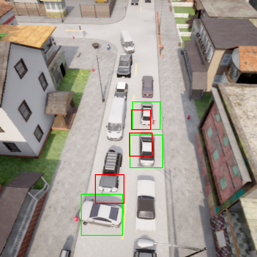
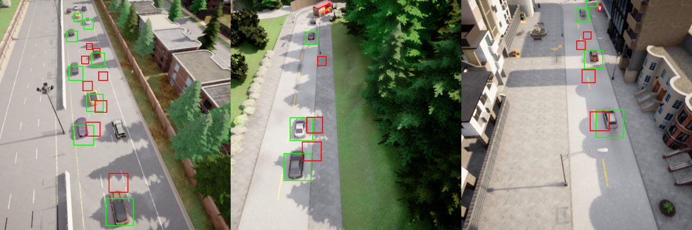

# 1003 · 数据构成审计(data-check)

> 2026-10-03 · 范围:训练数据 `mvp_full_v5`(**当前磁盘上是 09-04 重新生成的版本**,不是 08-17 训练 Stage-2 时用的原始版本,见 §5.1)、TAHRelM 训练缓存、闭环 dev 评测 episode。
> **FOV 标准(2026-10-03 定):以 Stage-2 实际训练为准,统一为 90°。** 已把 `default.yaml` 的 `output.fov` 改回 90。
> 复现:`python3 runs/data_audit/h5_stats.py && python3 runs/data_audit/summarize.py`(仓库根目录;只读 h5 的小字段,约 1 秒)。
> 关联:`1004_ablation_design.md`(冻结的实验设计)、memory `acot-uav-sticky-id-null`。

---

## 0. 摘要

| 项 | 值 |
|---|---|
| 训练数据(09-04 重生成版) | 64 集 · 85,271 帧(142 分钟,10 fps)· 5 个城镇(Town01/02/04/05/10HD)· 全部轿车目标 · 512² · 相机 FOV **70°**(原始 v5 与 Stage-2 训练、闭环均为 90°) |
| 帧构成 | 清晰可见 64.2% · 部分遮挡 25.5% · 遮挡(≥0.5)3.8% · 出画 6.4% |
| 最长出画 / 遮挡 | 18.0 s(= 录制截断上限)/ 13.6 s |
| ≥3 s 后重新入画且有相似车在场 | **36 次**(全数据) |
| TAHRelM 离线缓存 | 64 集 · 42,637 帧 · 目标在候选中 99.8% · **没有 ≥3 s 的缺席段** |
| TAHRelM DAgger | 23 集 · 2,156 tick · 缺席 ≥3 s 的段 22 个 |
| 闭环 dev(Town05,91000–19) | 每臂约 12–13k 帧 · 目标在画面内 64–71% · 12–16/19 集因目标连续出画 18 s 被截断 · **不建模遮挡** |

**主要问题**(详见 §5):
1. 09-04 重新生成的数据是真 70° 相机,但之后所有离线训练仍按 90° 投影候选框,候选框系统性偏离车辆。受影响的有 TAHRelM 全线、BC 居中、Qwen LoRA grounding 等;Stage-2 本身不受影响(§5.1)。
2. 训练数据里"相似车干扰下长时丢失后重捕获"的样本极少。
3. 评测城镇 Town05、Town10HD 都在训练集里。
4. 主指标看不到"把目标找回画面"的能力。
5. 闭环评测不建模遮挡。
6. 数据卡过时。

---

## 1. 数据路径

| 内容 | 路径 | 备注 |
|---|---|---|
| 训练原始数据 | `/nvidia/hque/data/carla_data/mvp_full_v5/episode_*.h5` | 64 集,37 GB;**09-04 重新生成**(种子 42,真 70°)。原始 v5 已在 09-04 被磁盘清理删除 |
| 重新生成说明 | `acot_note/904_mvp-regen-spec.md` | 记录删除原因、重生成命令和参数(当时按 FOV 70 生成) |
| 生成汇总 | `/nvidia/hque/data/carla_data/mvp_full_v5/batch_summary.json` | |
| CARLA 健康检查 | `/nvidia/hque/data/carla_data/healthchecks/` | |
| 数据生成配置 | `carla_uav_tracking/config/default.yaml` | `output.fov` **已于 10-03 由 70 改回 90**、`rgb_resolution: [512,512]`、`max_lost_seconds: 18` |
| 录制器 | `carla_uav_tracking/recording/recorder.py` | 07-30 版写死 `fov=90.0`;09-03 版改为读取 `output.fov` |
| 场景配置(录制与闭环共用) | `carla_uav_tracking/config/scenarios/mvp.yaml` | 5 个城镇、每集 4–8 辆干扰车、至少 2 辆相似车、每集 2 次制造丢失 |
| 标签后处理 | `carla_uav_tracking/recording/postprocess.py` | 框、出画、遮挡三类标签,按 70° 投影 |
| 训练配置 | `train/config_v5.yaml` | `image.fov_deg: 90`;`split_manifest: train/splits/__none_v5_naive__.json`(**文件不存在**) |
| 划分逻辑 | `train/dataset.py::_select_episodes` | 找不到划分文件时,按文件名排序,前 15% 作验证集,不设测试集 |
| 未使用的划分文件 | `train/splits/mvp_full_split.json` | 以 Town05 为测试城镇;v5 训练没有用它 |
| Stage-2 模型 | `runs/stage2_v5/stage2_best.pt` | 2026-08-17 训练,用的是原始 v5(实际 90°);ckpt 只存权重和指标,不存配置 |
| Stage-2 候选框投影 | `train/dataset_stage2.py:215` | 用配置里的 `fov_deg`(90) |
| TAHRelM 缓存生成 | `train/tah_cache.py` | 用配置里的 FOV(90),每 2 帧取 1 帧 |
| TAHRelM 离线缓存 | `runs/tah_cache.pt` | 64 集,2026-09-07 生成 |
| TAHRelM 离线 + DAgger 缓存 | `runs/tah_cache_dag.pt` | 前 64 集为离线,后 23 集为 DAgger |
| DAgger 原始数据 | `runs/dagger_v5/`、`runs/tahdag/` | 闭环收集 |
| 闭环逐集结果 | `carla_uav_tracking/rollout/eval_out/paper_dep_*.json`、`dev_sc_*.json`、`paper_asd_*_t10.json` | 由 scorer 写出 |
| 闭环 tick 日志 | `runs/asd/*.jsonl`、`runs/asd/deploy_all/*.jsonl`、`runs/asd/sticky_check/*.jsonl` | 每个决策 tick(0.6 s)一行 |
| 闭环相机与候选 | `rollout/env.py`(`fov_deg` 默认 90)、`rollout/candidates.py` | 相机和投影都是 90°;不做遮挡判断 |
| 本次审计 | `runs/data_audit/h5_stats.py`、`summarize.py`、`h5_rows.json`、`fov_check*.png` | |

---

## 2. 训练数据 `mvp_full_v5`

### 2.1 帧类别定义

标签由 `postprocess.py` 按 70° 相机计算,与图像一致(§5.1 已验证)。

| 类别 | 定义 |
|---|---|
| 清晰可见 | 在画面内,且 `occ_structural` = 0 |
| 部分遮挡 | 在画面内,且 0 < `occ_structural` < 0.5 |
| 遮挡 | 在画面内,且 `occ_structural` ≥ 0.5 |
| 出画 | `off_screen` = 1,即在画面外或在相机后方 |

`occ_structural` 指目标框 8 个角点射向相机、被建筑、树、桥挡住的比例,录制时由 `OcclusionDetector` 实时计算。

### 2.2 按城镇统计

| 城镇 | 集数 | 帧数(分钟) | 清晰可见 | 部分遮挡 | 遮挡 | 出画 | 最长出画 | 最长遮挡 | 最长不可见 |
|---|---|---|---|---|---|---|---|---|---|
| Town01 | 19 | 24,971(41.6) | 53.3% | 35.8% | 4.8% | 6.1% | 18.0 s | 7.0 s | 18.0 s |
| Town02 | 15 | 20,568(34.3) | 61.2% | 31.3% | 3.2% | 4.3% | 18.0 s | 4.5 s | 18.0 s |
| Town04 | 10 | 14,168(23.6) | 79.4% | 10.4% | 1.1% | 9.2% | 18.0 s | 6.7 s | 18.8 s |
| Town05 | 10 | 11,943(19.9) | 64.9% | 20.6% | 6.1% | 8.4% | 18.0 s | 12.6 s | 18.0 s |
| Town10HD | 10 | 13,621(22.7) | 72.7% | 18.1% | 3.8% | 5.5% | 18.0 s | 13.6 s | 18.0 s |
| **合计** | **64** | **85,271(142.1)** | **64.2%** | **25.5%** | **3.8%** | **6.4%** | 18.0 s | 13.6 s | 18.8 s |

### 2.3 不可见段时长分布

| 类型 | 段数 | <0.5 s | 0.5–1 s | 1–3 s | 3–5 s | 5–10 s | 10–30 s | ≥30 s |
|---|---|---|---|---|---|---|---|---|
| 出画 | 540 | 389 | 75 | 44 | 12 | 1 | 19 | 0 |
| 遮挡 | 372 | 225 | 66 | 58 | 11 | 7 | 5 | 0 |
| 不可见(出画或遮挡) | 871 | 585 | 135 | 97 | 20 | 8 | 26 | 0 |

- **出画上限 18 s 是录制截断造成的**(`max_lost_seconds: 18`)。≥ 10 s 的不可见段共 26 段:15 段到集末都没回来,目标重新入画的只有 11 段。
- **重新入画的长时不可见段**(集号、城镇、时长):000002 Town01 14.3 s · 000003 Town01 13.2 s · 000013 Town02 10.1 s · 000020 Town04 18.8 s · 000034 Town05 10.0 s · 000035 Town05 16.1 s 和 12.8 s · 000036 Town05 10.3 s · 000038 Town05 17.4 s · 000057 Town01 12.7 s 和 15.4 s。
- **最长遮挡的几集**:000042 Town10HD 13.6 s · 000036 Town05 12.6 s · 000032 Town05 12.0 s · 000034 Town05 10.0 s · 000044 Town10HD 9.7 s。

**按集统计:**

| 条件 | 集数(共 64) |
|---|---|
| 有 ≥ 3 s / ≥ 5 s / ≥ 10 s 的出画 | 22 / 17 / 16 |
| 有 ≥ 1 s / ≥ 3 s 的遮挡 | 26 / 18 |
| 完全没有出画 | 12 |
| 完全没有遮挡 | 14 |

### 2.4 重新入画事件与相似车共视

重新入画事件定义为:不可见至少 1 s 后,目标重新可见的那一帧。

| 条件 | 次数 |
|---|---|
| 全部重新入画事件 | 135 |
| 不可见 ≥ 3 s / ≥ 5 s 后重新入画 | 39 / 19 |
| 入画时画面里至少有 1 辆 / 2 辆相似车 | 129 / 114 |
| 入画时画面里有任意干扰车 | 134 |
| **不可见 ≥ 3 s 后重新入画,且有相似车在场** | **36** |

- 目标在画面内的帧中,76.1% 至少同时有 1 辆相似车,58.8% 至少有 2 辆。
- 只看含相似车的 51 集,这个比例是 97.5%。

### 2.5 场景与几何

| 项 | 值 |
|---|---|
| 目标类别 | 全部为轿车;`occlusion_biased` 全为 False,即没有专门构造的遮挡场景 |
| 相似策略 | 同色异型 27 · 同型异色 25 · 无相似车 12 |
| 每集相似车数(按 flag) | 0 辆 13 集 · 1 辆 1 集 · 2 辆 31 集 · 3 辆 19 集 |
| 每集干扰车数 | 3 辆 4 集 · 4 辆 11 · 5 辆 11 · 6 辆 15 · 7 辆 11 · 8 辆 12 |
| 无人机高出目标 | 中位 26 m(各集中位数的范围 16–34 m) |
| 水平距离 | 中位 22 m |
| 目标框(按 70° 投影的伪方框) | 中位 47 px;各集第 5 百分位最小约 18 px |
| 每集时长 | 中位 150 s,最短 12 s |
| 相机 | 512² · FOV 70°(09-04 重生成版;原始 v5 实际 90°)· 俯仰 −50° |
| 语言指令示例 | "Follow the gold Mini Cooper directly ahead, maintaining a tracking distance of about 30 m." 训练和推理时只保留身份描述(`neutralize_language`) |

### 2.6 训练集划分

- `config_v5.yaml` 指定的 `train/splits/__none_v5_naive__.json` 不存在,`_select_episodes` 回退为按文件名排序切分:前 `int(64 × 0.15)` = 9 集作验证集,其余 55 集作训练集,不设测试集。
- `test_town: Town05` 只在 `make_split.py` 里使用,v5 训练没有用到。
- **结论:Town05 和 Town10HD 都参与了训练。** 闭环评测用的是见过的城镇,只是种子不同(场景不同)。

---

## 3. TAHRelM 训练缓存

| 来源 | 集数 | 帧 / tick 数 | 时间分辨率 | 目标在候选中 | 每帧候选数 | 目标缺席段 |
|---|---|---|---|---|---|---|
| 离线(取自 `mvp_full_v5`) | 64 | 42,637 | 0.2 s | **99.8%** | 平均 4.4,最多 9 | 20 段,**最长 1.6 s,没有 ≥ 3 s 的** |
| DAgger(闭环收集) | 23 | 2,156 | 0.6 s | 82.1% | 平均 4.4 | 36 段:≥ 3 s 的 22 段,≥ 5 s 的 16 段,最长 18 s |

- **离线缓存里目标几乎一直"在候选中"(99.8%),而 h5 标签显示有 6.4% 的帧出画。** 原因是缓存按 90° 投影:实际已经出了 70° 画面的目标,按 90° 算仍在画面内(§5.1)。所以离线缓存基本不含"出画后重新入画"的样本。
- **TAHRelM 的重新入画样本几乎全部来自 23 集 DAgger。**
- DAgger 各集的 tick 数:68, 81, 136, 12, 134, 107, 139, 50, 101, 74, 50, 39, 150, 140, 63, 105, 140, 99, 85, 74, 56, 146, 107。

---

## 4. 闭环评测(dev:Town05,种子 91000–91019)

**设置:**
- 每集最多 900 步(90 s,10 Hz),相机 512²、FOV 90°。
- 91004 因目标静止被 scorer 跳过,计分 19 集。
- 场景启用"制造丢失"事件(`mvp.yaml` 的 `loss_events`):每集 2 次,每次 4.5–6.5 s,开始时让目标加速并变道。
- 提前结束只有一种原因:目标连续出画 ≥ 18 s 触发截断(`env.py`)。

### 4.1 帧构成与截断

| 臂 | 集数 / 计分 | 帧数 | 目标在画面内 | 出画 | 提前结束 | 其中锁对的集 |
|---|---|---|---|---|---|---|
| Sticky(10-03) | 20 / 19 | 13,349 | 70.8% | 29.2% | 12/19 | 4/11 |
| PGIF(10-03) | 20 / 19 | 12,344 | 68.6% | 31.4% | 14/19 | 7/10 |
| PGIF(10-02) | 20 / 19 | 12,067 | 66.3% | 33.7% | 14/19 | 8/11 |
| TAHRelM(10-02) | 20 / 19 | 12,086 | 63.9% | 36.1% | 13/19 | 2/4 |
| xattn(10-02) | 20 / 19 | 11,857 | 66.1% | 33.9% | 16/19 | 2/2 |
| DAM4SAM(10-02) | 20 / 19 | 12,434 | 67.1% | 32.9% | 12/19 | 4/6 |

"锁对的集"指该集正确锁定比例 > 0.5。"其中锁对的集"一列是 x/y:锁对的 y 集里有 x 集提前结束。

**即使身份锁对,也常因目标连续出画 18 s 被截断。** 这说明锁对之后,把目标重新拉回画面(WHERE / 控制)也经常失败。

### 4.2 缺席段

数据来自 tick 日志,是下界:画面里一辆车都没有的 tick 不记录。

| 日志 | 缺席段数 | ≥ 3 s | ≥ 5 s | ≥ 10 s | 最长 |
|---|---|---|---|---|---|
| TAHRelM 观察模式,Town05 | 35 | 19 | 13 | 8 | 18.0 s |
| TAHRelM + PGIF(10-02),Town05 | 34 | 16 | 9 | 6 | 18.0 s |
| TAHRelM 观察模式,Town10HD | 44 | 20 | 15 | 9 | 18.0 s |
| TAHRelM + PGIF,Town10HD | 36 | 16 | 13 | 6 | 18.0 s |

### 4.3 遮挡

闭环里**不计算、不记录**遮挡。`candidates.py` 只按"是否在画面内"生成候选,被遮挡的车照样进入候选集。`scene/occlusion.py` 已实现,但没有接入。

---

## 5. 发现的问题

### 5.1 FOV 不一致(最严重)

| 环节 | FOV | 依据 |
|---|---|---|
| 训练数据录制与标签 | 70° | `default.yaml` 的 `output.fov: 70`;下图可视化验证 |
| Stage-2 候选框投影 | 90° | `dataset_stage2.py:215` 读 `config_v5.image.fov_deg` |
| TAHRelM 离线缓存投影 | 90° | `tah_cache.py` 读同一配置 |
| 闭环相机与候选投影 | 90° | `env.py` 默认 `fov_deg=90`,`run_rollout.py` 没有覆盖;`candidates.py` 读配置里的 90 |

**可视化验证**(绿框按 70° 投影,红框按 90° 投影):

- **4 帧里,70° 的框都落在车上。** 抽样:集 000010 第 200 帧、000030 第 400 帧、000050 第 900 帧、000003 第 120 帧。
- **90° 的框整体偏向图像中心、尺寸偏小,多数落在空路面上,个别落到别的车上。** 偏移量约为"到图像中心距离的 30%"(tan 35° / tan 45° ≈ 0.70)。

**时间线(10-03 核实):**

| 日期 | 事件 | 相机实际 FOV | 依据 |
|---|---|---|---|
| 07-30 | 录制器写死 `bp.set_attribute("fov", "90.0")` | 90° | git `73ea3ac:recording/recorder.py:280` |
| 08-11 → 08-17 | 生成原始 v5(512²)。配置本意是 70°,但录制器仍写死 90° | **90°** | `907_transition-diary-801.md` §7.6:"v5 本意 FOV 70,但渲染实际等效 fov90(投影中心 + 尺寸零误差、bbox GT = 27px 双证)" |
| 08-17 | 用原始 v5 训练 Stage-2(`config_v5` 为 90°) | 90°,投影一致 | `runs/stage2_v5/stage2_best.pt` 08-17 01:24 |
| 08-17 → 09-03 | 录制器改为读取 `output.fov`(当时是 70) | — | git `c3f6768`(09-03)中录制器已改 |
| 09-04 | 原始 v5 被磁盘清理删除,按 FOV 70 重新生成(种子 42,不同 episode) | **真 70°** | `904_mvp-regen-spec.md`;h5 修改时间 09-04 06:01–06:42;本节可视化 |
| 09-04 之后 | 所有离线训练和缓存仍按 `config_v5` 的 90° 投影 | 70° 图像 + 90° 投影,**错位** | 见下表 |

**结论:Stage-2 训练时数据是 90°,投影也是 90°,两者一致,不受影响。** 日记 §7.6 对原始数据是正确的。问题只出在 09-04 重新生成的数据上,以及之后基于它的离线训练。闭环相机是 90°,与 Stage-2 训练一致。

**受影响与不受影响的产物:**

| 产物 | 时间 | 数据来源 | 状态 |
|---|---|---|---|
| Stage-2 v5 及其消融(`stage2_v5{,_nolang,_noear,_noiar,_fair}`) | 08-17 – 08-18 | 原始 v5(90°) | **不受影响** |
| 各类 grounding 头(`tid_*.pt`、`tid_attrbind*.pt`) | 08-19 – 08-27 | 原始 v5(90°) | **不受影响** |
| 闭环评测(相机和候选投影) | — | 实时渲染 90° | **不受影响** |
| reid 度量学习(`reid_metric_cache_proj.pt`) | 09-04 07:23 | 重生成数据 | 可能受影响(在重生成之后,读配置里的 90°) |
| BC 居中(`bc_center_cache*.pt`、`stage2_bc_center*.pt`) | 09-04 22:33 起 | 重生成数据 | **受影响**:`bc_center_train.py:78` 按 90° 计算居中目标。"控制侧修取景证伪"中 BC 那一半的证据需要复核 |
| RL E0 居中(`stage2_rl_e0.pt`) | 09-05 | 待查 | `rl_e0_center.py` 使用投影;若训练读了重生成数据,则受影响 |
| TAHRelM 全线(`tah_cache.pt`、`tah.pt`、`tah_rel.pt`、`tah_cache_dag.pt`、`tah_rel_dag.pt`、`tah_relm_dag.pt`) | 09-07 – 09-08 | 重生成数据 + DAgger | **受影响**:离线部分(64 集)的外观裁剪错位,且目标几乎一直被判为在画面内;DAgger 部分(闭环 90°)一致 |
| Qwen LoRA grounding(`runs/qwen_lora/`) | 10-02 | 重生成数据 | **受影响**:`qwen_lora_grounding.py:45` 写死 `FOV = 90.0` |
| `reid_resolution_probe`、`baseline_deadreckon` 等离线探针 | 09-04 之后的运行 | 重生成数据 | 09-04 之后的运行结论需复核 |

**已采取的措施(10-03):** `default.yaml` 的 `output.fov` 改回 90,与 Stage-2 训练和闭环相机一致。以后重新生成的数据会是 90°。当前磁盘上的 70° 数据没有改动。

### 5.2 重捕获样本稀缺

- 全数据中,不可见 ≥ 3 s 后重新入画且有相似车在场的只有 36 次。
- TAHRelM 离线缓存里实际上是 0 次(受 §5.1 影响),只有 DAgger 的 22 段可用。
- 没有构造遮挡场景(`occlusion_biased` 全为 False)。

这与论文的杀手场景"长时丢失 + 相似车并存的重捕获"不匹配。

### 5.3 评测城镇在训练集中

见 §2.6。"跨地图泛化"需要换成真正没见过的城镇,例如 Town03(不在训练数据中),或改用 `mvp_full_split.json` 那样按城镇留出的划分重训。

### 5.4 指标盲区

- 主指标"正确锁定比例"只在目标在画面内的帧上统计。
- 因丢失 18 s 被截断的集,截断后的时间不计入分母。所以"把目标找回画面"的能力在主指标里看不到。
- §4.1 显示,锁对的集里仍有 30–70% 被截断。

### 5.5 遮挡只存在于训练标签

训练数据有完整的遮挡标签:3.8% 帧遮挡,25.5% 部分遮挡。闭环评测完全不建模遮挡(§4.3)。

### 5.6 数据卡过时

`727_dataset-card.md` 记的是 MVP v1 的数据:60 集、100,603 帧、336 px、FOV 90,目标包含摩托和自行车。原始 v5(已删除)是 512 px、实际 FOV 90;当前重生成版是 64 集、85,271 帧、512 px、FOV 70,目标只有轿车。

---

### 5.7 无人机穿楼(v6 冒烟时发现,旧数据很可能同样存在)

- **原因:** 无人机是运动学模型,没有碰撞;原避障只保证最低离地高度(`carla_uav/obstacle_avoidance.py`,注释假设"CARLA 楼高很少超过 30 m")。Town05、Town10HD、Town03 有高楼和高架,镜头会进入楼体,或贴住墙面、桥墩。
- **影响:** 这类帧会被标成"结构遮挡",持续约 12 s 后才因 `max_occluded_seconds` 截断。本审计 §2 中最长的几段遮挡(000042 Town10HD 13.6 s、000036 Town05 12.6 s 等)需要逐一目检确认。
- **闭环评测同样可能出现**,但闭环不经过专家避障。
- **修复:** v6.1 已修(见 `1003_data-regen-v6-spec.md` §7)。

### 5.8 目标长时间静止

- **现象:** 09-04 版数据中,目标速度 < 1 m/s 的帧平均占 41%,64 集里有 26 集超过一半时间静止。原因是红灯和背景车排队。
- **影响:** 静止段对跟踪和重捕获信息量很低,也是制造丢失失效的原因之一。
- **修复:** v6.1 让目标和干扰车忽略红绿灯,并加质检门 G9。

## 6. 待办(按优先级;除 `default.yaml` 外均未执行)

1. **按 90° 重新生成 `mvp_full_v5`**(`default.yaml` 已改好),然后重建 `tah_cache*.pt` 并重训 TAHRelM。1004 的 T0 本来就要重训 TAHRelM(第 1 节),应改用新数据。需要 CARLA 渲染数小时。
   - 备选:不重录,直接在当前 70° 数据上改用 70° 投影重建缓存。这样能消除错位,但训练数据(70°,目标更大)与闭环(90°)的成像尺度不一致。
2. **复核受 FOV 错位影响的结论**:BC 居中负结果、RL E0、Qwen LoRA grounding、09-04 之后的离线探针。
3. **补"长时丢失 + 相似车并存"的数据。** 打开 `occlusion_biased`,或提高 `loss_events` 的比例。可以和第 1 条的重新生成合并做。
4. **评测协议。** 接入遮挡判断(`scene/occlusion.py`);ID 在出画或遮挡后断开;加入未见城镇;补"找回画面"类指标,例如重捕获率和重捕获延迟。
5. **更新 `727_dataset-card.md`。**

以上会改动 T0 和训练流程,按 1004 的冻结规则,需要以带日期的变更记录追加,并在任何 test 运行之前完成。

---

## 7. 重新生成前的 Codex 审核(R1,2026-10-03)

> 原文:`codex/1003_data_regen_R1.md`;提示词:`runs/data_audit/codex_regen_prompt.txt`。
> 结论:**需要补充要求后再生成**。关键证据已抽查属实。

**MUST**
1. **统一 90° 口径,并把相机参数写进 h5 attrs。** 包括 fov、分辨率、俯仰、vehicle_size_m、框尺寸上下限、配置快照。`postprocess.py` 优先读 attrs,读不到就报错,不再静默回退到 90°。验收:抽 20 集,按 attrs 投影的框与标注逐帧误差 < 1 px。
2. **生成真实存在的划分文件**(例如 `train/splits/mvp_full_v5_90_split.json`),并让 `config_v5*` 指向它。找不到划分文件时直接报错。测试城镇的留出规则要和 1004 的预注册一致。
3. **补足重捕获和遮挡的配额。** 用"基础集(复刻原始 v5)+ 遮挡/重捕获加重子集"的分层生成;"≥ 3 s 后重新入画且有相似车在场"的事件要达到数百次量级。
4. **新增真实关联所需的标签。** 每个目标和干扰车都要有:`visible`、`off_screen`、`occ_structural`,以及按规则会断开的 `tracklet_id`(与持久 `actor_id` 并存)。
5. **闭环候选要接入遮挡判断。** 否则论文只能称为"理想检测设定"。
6. **重建 TAH 缓存;若部署策略或候选协议改变,重收 DAgger。**

**SHOULD**
- 分布以原始 v5 和闭环相机为准:512²、90°、俯仰 −50°。
- 清理写死的常量:`qwen_lora_grounding.py:45`、`train/labels.py`(仍是 336)、`scripts/qc_report.py`(写死 90°)。
- attrs 写入 git commit、dirty diff、命令、镜像、CARLA 版本。
- QC 改为自动门槛。
- 版本化目录 + sha256 + 只读备份。

**NICE**
- 更新数据卡。
- `run_rollout.py` 暴露 fov / 分辨率参数。
- 每个城镇先各生成 1 集做 smoke 测试。

**其他风险**
- 工作区未提交的改动很多,无法还原代码状态。
- `run_resilient.sh` 编号可能有空洞。
- 专家录制的数据与闭环 on-policy 分布不同。

---

## 变更记录
- 2026-10-03 v1:初稿。
- 2026-10-03 v2:核实 FOV 时间线。Stage-2(08-17)用的是原始 v5,实际 90°,与 `config_v5` 一致,不受影响;错位只出现在 09-04 重新生成(真 70°)之后的离线产物上。按"以实际训练为准",把 `default.yaml` 的 `output.fov` 改回 90。§5.1 新增时间线和受影响产物表,§6 待办重排。
- 2026-10-03 v3:新增 §7 Codex 重新生成前审核摘要。
- 2026-10-03 v4:新增 §5.7 无人机穿楼、§5.8 目标长时间静止(v6 冒烟时发现)。
- 2026-10-03 v5(另一会话，协调备注):§6 待办第 1 条已由 1004 TAHRelM 修正重训线程执行一个**忠实 90° 复刻**,不是 v6。场景配置和种子(42–107)都与 09-04 版相同，只把 FOV 改为 90。输出到新目录 `/nvidia/hque/data/carla_data/mvp_full_v5_fov90/`(按种子命名);原 70° 的 `mvp_full_v5` 未动。详见 `1004_tahrelm_retrain_diag.md` §5。v6 的正式重新生成(Codex MUST 项)不受影响。
