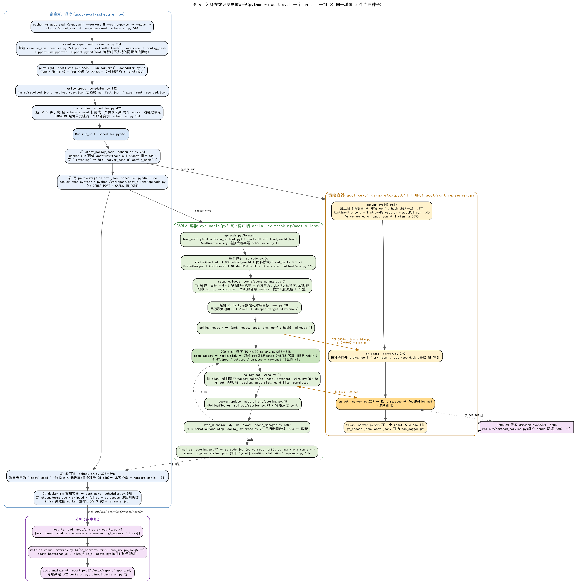
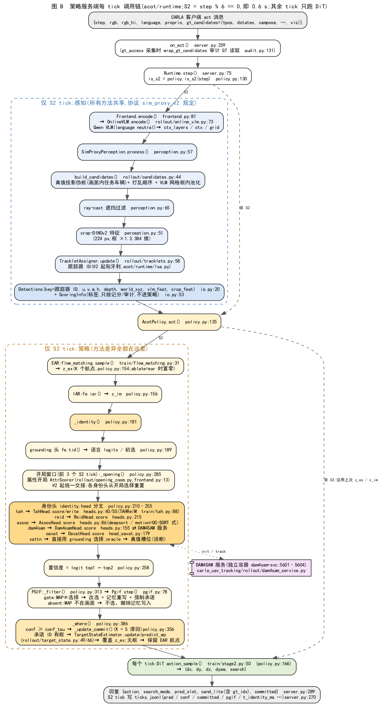
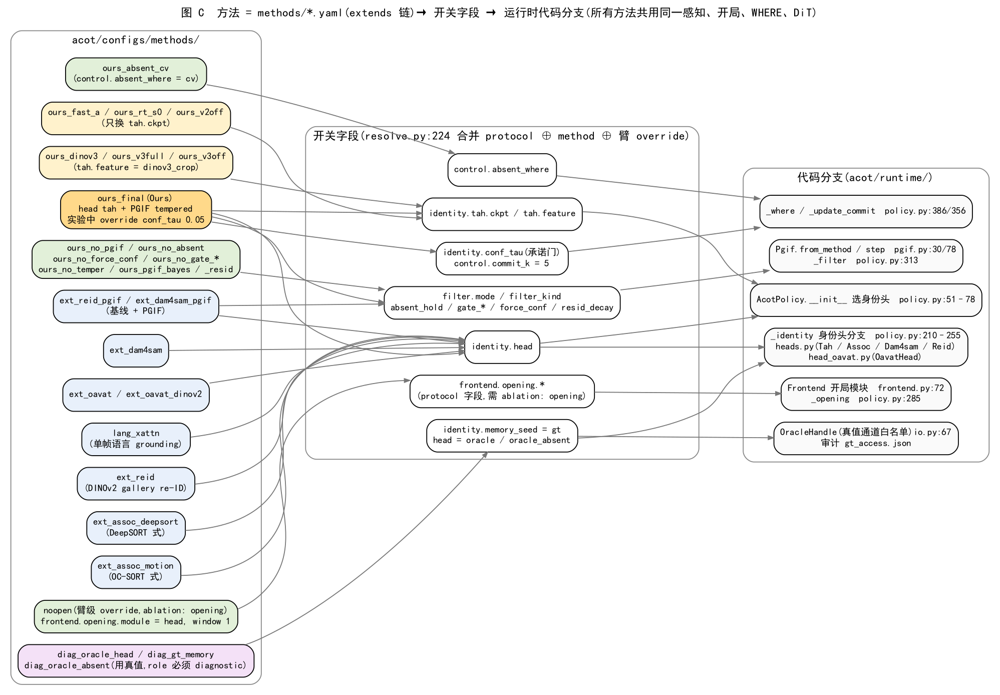

# 1012 闭环在线评测:实现路径与调用流程

> 2026-10-12 整理,对应当时的代码(行号会随修改漂移,以函数名为准)。回答:"在线闭环测试的实现脚本在哪看;Ours、baseline、ablation 分别走哪段代码"。
> 简写约定:文中不带目录的 `policy.py / server.py / heads.py / pgif.py / perception.py / frontend.py / io.py / support.py` 都在 `acot/runtime/`;`scheduler.py` 在 `acot/eval/`;`resolve.py` 在 `acot/config/`。旧实现 `carla_uav_tracking/rollout/policy.py` 一律写全路径。
> 配套的模型 / 基线 / 消融架构图:`figs/fig_architecture_v4.png`、`figs/fig_arch_baselines.png`、`figs/fig_arch_ablations.png`;本文三张图只画代码调用路径。
> 设计背景见 `1004_code_framework.md`(框架设计稿)、`1006_experiment_design_cvpr.md`(协议 @2/@3 的改动)。

## 0. 一页速查

| 想看什么 | 文件 |
|---|---|
| 唯一入口(CLI) | `acot/cli.py`(`python -m acot eval <experiment.yaml>`) |
| 实验 = 种子 × 组(arm) | `acot/configs/experiments/*.yaml` |
| 协议(相机、tick、感知、开局、记分) | `acot/configs/protocols/sim_proxy_v2@{1,2,3}.yaml` |
| 方法(Ours / 基线 / 消融 / 诊断) | `acot/configs/methods/*.yaml`(`extends` 链,根是 `_base.yaml`) |
| 机器资源(CARLA 端口、GPU、镜像、DAM4SAM 服务) | `acot/configs/infra/default.yaml` |
| 配置合并 + 哈希 | `acot/config/resolve.py`(`resolve_experiment` / `resolve_arm`) |
| 调度:起容器、派种子、看门狗、重试 | `acot/eval/scheduler.py` |
| **CARLA 客户端**(仿真、发观测、执行动作、记分) | `carla_uav_tracking/acot_client/episode.py` + `scoring.py` + `wire.py` |
| **策略服务端**(收观测、返回动作) | `acot/runtime/server.py` |
| 共享前端:VLM + Stage-2(EAR/IAR/DiT/grounding)+ 开局模块 | `acot/runtime/frontend.py` |
| 共享感知:候选框、遮挡、跟踪器 ID | `acot/runtime/perception.py` |
| **策略决策逻辑(所有方法的分支都在这里)** | `acot/runtime/policy.py`(`AcotPolicy`) |
| 身份头:Ours(TAHRelM)、re-ID、DeepSORT/OC-SORT 式、DAM4SAM | `acot/runtime/heads.py` |
| 身份头:OA-VAT | `acot/runtime/head_oavat.py`(调用 `external/OA-VAT` 原代码) |
| PGIF 滤波 | `acot/runtime/pgif.py` |
| DAM4SAM 服务(独立 conda 环境 / 容器) | `carla_uav_tracking/rollout/dam4sam_service.py` |
| 结果读取 / 指标 / 统计 / 报告 | `acot/analysis/{results,metrics,stats,report}.py` |
| 某次具体判定 | 如 `acot/analysis/p02_decision.py`、`dinov3_decision.py` |
| 运行时能力白名单(acot 运行时拒绝不支持的配置) | `acot/runtime/support.py` |

一句话:**所有方法共用同一个客户端、同一个服务端进程、同一套感知 / 开局 / WHERE / DiT;方法之间只在 `AcotPolicy._identity()` 的身份头分支、PGIF 开关和承诺门限上不同。**

## 1. 怎么跑

```bash
# 先起 CARLA(eval 不会自动拉起;参照 runs/acot_logs/t0/chain_O2a.sh);DAM4SAM 组还需 dam4sam-svc 服务在线
python -m acot show acot/configs/experiments/p02_fast_a_devB3.yaml --diff        # 看每组相对 _base 改了什么
python -m acot eval acot/configs/experiments/p02_fast_a_devB3.yaml --dry-run     # 只解析、不跑
python -m acot eval acot/configs/experiments/p02_fast_a_devB3.yaml \
    --workers 7 --carla-ports 2050,2060,2070,2080,2090,2230,2250 --gpus 1,2,4,5,7,3,6 [--arms a,b] [--seeds 93060-93064]
python -m acot analyze acot/configs/experiments/<exp>.yaml                       # 通用报告(不完整则拒绝出统计)
python -m acot.analysis.p02_decision --stage a                                    # 某个预注册判定
```

结果目录:`carla_uav_tracking/rollout/eval_out/exp/<experiment>/<arm>/seeds/<seed>/`。

## 2. 总体流程(图 A)



源文件:`figs/fig_closed_loop_overview.dot`。三个进程 / 容器:

| 角色 | 在哪运行 | 代码 | 做什么 |
|---|---|---|---|
| 调度器 | 宿主机 | `acot/eval/scheduler.py` | 解析配置、租 CARLA 端口和 GPU、起策略容器、在 CARLA 容器里执行客户端、看门狗、重试、定种子状态 |
| 客户端 | CARLA 容器 `cyh-carla`(py3.8) | `carla_uav_tracking/acot_client/episode.py` → `rollout/env.py` | 生成场景、推进仿真、取帧、读真值、发观测、执行动作、**记分** |
| 策略服务端 | 策略容器 `acot-<exp>-<arm>-w<k>`(py3.11,1 张 GPU) | `acot/runtime/server.py` → `policy.py` | 感知(候选框 + 跟踪器)、身份决策、动作;**写 ticks.jsonl / gt_access.json** |
| DAM4SAM 服务(仅 DAM4SAM 组) | `dam4sam-svc` 容器,端口 5601–5604 | `carla_uav_tracking/rollout/dam4sam_service.py` | SAM2.1-L 的 init / track |

调度要点(`scheduler.py`):
1. `run_experiment`(:514):解析 → `runtime_problems`(acot 运行时不支持的配置直接报错)→ 静态预检 → `workers()`(:87,每个 worker = 1 个在线 CARLA 端口 + 1 张空闲 ≥ 20 GB 的 GPU + 文件锁租约 + TM 端口块)→ 写规格 → 分派。
2. 有 `schedule:` 的实验用 `Dispatcher`(:426):把 (组 × 同城镇连续 5 个种子) 单元按 `schedule.seed` 打乱成一个共享队列,各 worker 线程抢单元,保证各组在时间和机器上交错;infra 失败的种子换一台 worker 单独重排,最多 3 次。
3. 每个单元 `run_unit`(:328):起策略容器 → 等 `listening` 并核对回显哈希 → `docker exec` 客户端 → 看门狗(数 `[acot] seed=` 行,12 min 无进展,首个种子 25 min,则杀客户端并重启该 CARLA)→ 删策略容器 → `post_part`(:398)定状态。
4. CARLA 服务器**不会**被 `acot eval` 自动拉起(只在挂死后重启);DAM4SAM 服务是外部常驻,只做健康检查。

## 3. 策略服务端每个 tick 的调用链(图 B)



源文件:`figs/fig_closed_loop_tick.dot`(`dot -Tpng -Gdpi=130 … -o …png` 重新渲染)。

要点:
1. **两种 tick**。仿真 10 fps,每个 act 消息对应 1 帧。`step % s2_period(6) == 0` 是 S2 tick(0.6 s 一次),跑 VLM、感知、EAR/IAR、身份决策、WHERE;其余 tick 只用上次的 `z_ex / z_im` 跑 DiT(`policy.py:130,165`)。
2. **感知对所有方法相同**(协议 `sim_proxy_v2` 规定,`perception.py`):真值投影伪框 → ray-cast 遮挡过滤 → crop-DINOv2 特征 → 跟踪器 ID。策略只看到 `Detection`(key 是跟踪器 ID,不是仿真 actor 编号);真值标签放在 `ScoringInfo`,只用于记分和审计。
3. **EAR 每个 S2 tick 都采样**(`policy.py:154`)。只有当承诺 ID 本 tick 有框时,WHERE 才用匀速估计器的航点覆盖它(`policy.py:395–401`);无框时 DiT 吃的是 EAR 航点。
4. **身份决策顺序**(`_identity`,`policy.py:181`):grounding 初选 → 开局窗口(前 3 个 S2 tick,属性开局)→ 身份头打分 → 置信度 = logit top1 − top2(`policy.py:258`)→ PGIF(若开)→ 返回;然后 `_where` 按 `conf ≥ conf_tau` 决定是否更新承诺(K = 5 滞回)。
5. 每个 S2 tick 写一行 `ticks.jsonl`(`server.py:270`):`pred / conf / committed / pgif / t_identity_ms / keys / gt / true …`,`p02_decision.py` 等的耗时和间隔分析都读它。

## 4. 方法 → 配置 → 代码分支



配置合并规则(`resolve.py:224 resolve_arm`):`protocol ⊕ method(extends 链)⊕ 臂 override ⊕ CLI override`。方法字段(`control / identity / filter / …`)可以直接 override;协议字段(`frontend.* / perception.*`)只有臂声明了 `ablation: opening|frontend|perception` 才能改;`camera / sim / scorer` 是协议不变量,要改只能升协议版本。用到真值的组必须在 `diagnostics` 中列出所用真值通道,且 role 必须是 `diagnostic`。最终每组得到一个 `config_hash`,服务端启动时重算并核对(`server.py:171`),不一致拒绝启动。

### 4.1 Ours

| 项 | 内容 |
|---|---|
| 方法文件 | `acot/configs/methods/ours_final.yaml`:`identity.head: tah`,`tah.ckpt: runs/tah_relm_dag.pt`,`filter: {mode: filter, filter_kind: tempered, absent_hold: true, absent_max: 8}`;文件里 `conf_tau: 0.5`,**当前 Ours 在实验里 override 为 0.05** |
| 身份头 | `TahHead`(`heads.py:15`)→ `TAHRelM`(`train/tah.py:88`,4,740 参数,7 个相对特征;记忆 {app, pos, vel})。每个 S2 tick:`score()` → `write(pred_slot)` 用自己的选择更新记忆(`policy.py:240–255`) |
| PGIF | `Pgif`(`pgif.py`)tempered:证据 `L_k ← 0.98·L_k + (0.5 + 置信度分位)`;MAP ≠ 选择时改选、重写记忆、强制承诺(`force_conf`);MAP 不在画面时输出 absent,撤销本 tick 记忆写入(`policy.py:313–353`) |
| 当前 Ours 数字的来源 | `opt1_screen_devB3/tau005`(重复 0)+ `opt2a_screen_devB3/tau005_r1`(重复 1),dev-B @3,承诺正确 0.525 |
| 换权重的变体 | `ours_fast_a`(10-12 P0-2 新权重)、`ours_rt_s0`、`ours_v2off`:只换 `tah.ckpt`;`ours_dinov3 / ours_v3full / ours_v3off`:TAH 特征换成 DINOv3(`policy.py:54–58`) |

### 4.2 外部基线(全部共享属性开局和统一交接,只替换"身份头")

| 基线 | 方法文件 | 身份头代码 | 调参后参数(`t0_grid_devB` 网格选出) | 论文对比数字来源(dev-B @3) |
|---|---|---|---|---|
| DINOv2 gallery re-ID | `ext_reid.yaml` | `ReidHead`(`heads.py:195`):K 视图外观库,先用旧库选、再把承诺身份的视图存入库 | tavg 0,conf_tau 0.05 | `t0_grid_devB/reid_a0p0_t0p05`(0.636) |
| DeepSORT 式 | `ext_assoc_deepsort.yaml` | `AssocHead(mode=deepsort)`(`heads.py:75`):匀速位置门控 + λ·外观 cosine | gate 160,λ 2,conf_tau 0.2 | `t0_grid_devB/deepsort_g160_l2_t0p2`(0.569) |
| OC-SORT 式 | `ext_assoc_motion.yaml` | `AssocHead(mode=motion)`:只有运动 | gate 120,conf_tau 0.05 | `t0_grid_devB/ocsort_g120_t0p05`(0.392) |
| DAM4SAM | `ext_dam4sam.yaml` | `Dam4samHead`(`heads.py:126`):开局框 init SAM2.1-L,之后每 S2 tick `track`,取预测框中心最近的候选(gate_px 内);经 socket 调 `dam4sam_service.py` | gate 160,conf_tau 0.05 | `t0_grid_devB/dam4sam_g160_t0p05` + `opt2a_screen_devB3/dam4sam_r1`(r = 2,0.720) |
| OA-VAT(CVPR 26) | `ext_oavat.yaml`(DINOv3)/ `ext_oavat_dinov2.yaml` | `OavatHead`(`head_oavat.py:109`):复用 `external/OA-VAT` 的匹配、参考库、卡尔曼;锁定 ID 可见就保持,丢失后 IoU 邻域重捕获 / 全图重检 | reacq 0.80,conf_tau 0.5 | `t0_grid_devB/oavat_r0p80_t0p5`(0.622) |
| xattn(单帧语言) | `lang_xattn.yaml` | 无身份头:直接用 grounding 头的选择(`policy.py:189–191`) | conf_tau 0 | `t0_grid_devB/xattn_t0p0`(0.634) |
| 基线 + PGIF | `ext_reid_pgif.yaml` / `ext_dam4sam_pgif.yaml` | 同上 + `filter.mode: filter` | — | `opt1_screen_devB3/reid_pgif`、`opt2a_screen_devB3/dampgif` |

完整对比表与 CI 见 `1007_closed_loop_summary.md` §4b(计算文件 `runs/acot_logs/t0/sec4b_update_1008.json`)。

### 4.3 消融

| 消融 | 怎么实现 | 改动的代码路径 | 在 @3 下跑过的实验 / 组 |
|---|---|---|---|
| w/o PGIF | `ours_no_pgif.yaml`:`filter.mode: off` | `self.pgif = None`(`policy.py:81`),跳过 `_filter` | `t0_pilot_deploy_devB3/nopgif_r0,r1`;`opt1_screen_devB3/nopgif_tau005` |
| w/o 属性开局 | 臂级 override `frontend.opening.module: head, window: 1`(需 `ablation: opening`) | `Frontend.opening = None`(`frontend.py:73`),开局 = grounding 选择 | `t0_pilot_deploy_devB3/noopen_r0,r1` |
| 共享开局(机制对照) | override `frontend.opening.shared: {file: acot/configs/shared_opening/devB3.json}` | `Runtime.shared_slot`(`server.py:96`)把参考 actor 映射成槽位,强制开局(`policy.py:194–207, 259–266`) | `t0_pilot_mech_devB3/*_sh_*` |
| w/o 缺席保持 | `ours_no_absent.yaml`:`absent_hold: false` | `Pgif.step` 不输出 absent | `opt1_screen_devB3/noabsent_tau005` |
| w/o 强制承诺 | `ours_no_force_conf.yaml` | gate 后按证据间隔走普通承诺规则(`policy.py:346–351`) | `opt1_screen_devB3/noforce, noforce_tau005` |
| 承诺门限 | override `identity.conf_tau` | `_where` 的 `confident` 判定(`policy.py:390`) | `opt1_screen_devB3/tau005, tau02`;`p02_fast_a_devB3/fa_cal_*`(0.63) |
| 记忆写承诺身份 | override `identity.tah.memory_write: committed` | `_tah_write_slot`(`policy.py:273`) | `opt2a_screen_devB3/memw_tau005` |
| PGIF 证据继承 | override `filter.inherit: true` | `Pgif._inherit`(`pgif.py:55`) | `opt2b_screen_devB3/*` |
| 缺席时匀速外推 / 匈牙利跟踪器 | `ours_absent_cv.yaml` / override `perception.tracker.assign` | `_where` 的 `absent_where == cv` 分支(`policy.py:402`);`perception.py:23` | `ab_where_assign`(@1) |
| 其他已定义、尚未在 @3 跑过 | `ours_no_temper`、`ours_pgif_bayes`、`ours_pgif_resid`、`ours_no_gate_commit`、`ours_no_gate_memory` | `pgif.py`(resid / bayes 分支)、`policy.py:333–345` | — |
| w/o EAR / w/o IAR | `control.ablate: ear / iar`(`policy.py:150–158`) | 需要配套的 Stage-2 权重;**目前没有实验用过** | — |

### 4.4 诊断(用真值,只作上界 / 分析,role 必须为 diagnostic)

| 诊断 | 方法文件 | 真值通道 | 代码 |
|---|---|---|---|
| 真值身份头(U1) | `diag_oracle_head.yaml` | `oracle_head` | `policy.py:232–239`,`OracleHandle.true_slot`(`io.py:78`) |
| 真值刷新记忆(U2) | `diag_gt_memory.yaml` | `gallery_seed_gt` | `policy.py:250–252` |
| 完美"目标不在画面"检测 | `diag_oracle_absent.yaml` | `oracle_absent_abstain` | `policy.py:315–331` |

真值访问由 `OracleHandle` 白名单限制(只开放方法声明过的通道),并由 `acot/runtime/audit.py` 在每个种子写 `gt_access.json`;调度器发现越权读取会把该种子判为失败(`scheduler.py:411–416`)。

## 5. CARLA 客户端(每个种子)

调用链(`carla_uav_tracking/` 下):
1. `acot_client/episode.py:36 main`:读 `parts/<tag>.client.json`(调度器在 `scheduler.py:348–366` 由协议 + 方法生成:fps、分辨率、FOV、步数、记分参数、blank 规则等)→ `load_config()`(`rollout/run_rollout.py`,default.yaml + scenarios/mvp.yaml)→ `load_world(town)` → `AcotRemotePolicy` 连上策略容器(`acot_client/wire.py:12`)。
2. 每个种子(`episode.py:56`):写 `status=partial` → @3 下 `reload_world` + 先切同步模式再生成场景(`:64–71`)→ `SceneManager` + `AcotScorer` + `StudentRolloutEnv` → `env.run(900)`(`rollout/env.py:165`)。
3. 场景(`scene/scene_manager.py:74 setup_episode`):按种子播种 random / numpy / TrafficManager;目标 + 4–8 辆相似干扰车放在同一路段,外加背景车流;无人机是运动学模型(`KinematicDrone`,无物理),相机俯仰每集固定;指令由 `build_instruction`(:281)生成完整指代句,服务端 `language_mode: neutral` 只保留颜色 + 车型(`rollout/online_vlm.py:37 apply_language_mode`)。
4. 暖机(`env.py:203–213`):专家控制跑 90 tick 让无人机对准目标;目标最大速度 < 1.2 m/s 则整集 skipped(`target stationary`,预注册允许跳过)。这两个常数写死在 `env.py`。
5. `policy.reset()` → 发 `{cmd: reset, seed, arm, config_hash}`(`wire.py:18`)。
6. 900 tick 循环(`env.py:236–318`,10 Hz,90 s;顺序是 "tick → 取帧 → 决策 → 移动"):
   - `step_target` → `world.tick()` → 取 512² 帧;step 0 / 6 / 12 另取 3 倍分辨率帧 `rgb_hi` 供开局用(`:249–254`);
   - 读真值:目标位置 `tpos`、干扰车状态 `dstates`、相机位姿 `campose`、ray-cast 可见性 `vis`(`:257–271`);这些只给服务端的协议感知用(产生候选框)和记分,不直接给控制;
   - `policy.act`(`wire.py:24`):按 blank 规则清空 `target_color / target_bp`、road、retarget(`wire.py:25–30`),发 act 消息;
   - `scorer.update`(`acot_client/scoring.py:45`)→ `scene.step_drone(dx, dy, dz, dyaw)`(`scene_manager.py:1500` → `carla_uav/drone.py:73`)→ 移相机;
   - 目标连续出画 18 s → 截断(`rollout/metrics.py:199`)。
7. 结束:`scorer.finalize()` → `episode.json`、`scenario.json`、`status.json`,打印 `[acot] seed=… status=…`(`episode.py:101–109`);全部种子跑完后发 `close`。

**通信协议**(`carla_uav_tracking/rollout/bridge.py`):TCP,8 字节大端长度前缀 + pickle(protocol 2,py3.8 ↔ py3.11 兼容)。

| 消息 | 内容 |
|---|---|
| reset | `{cmd: reset, experiment, arm, config_hash, seed}` → `{ok}` |
| act 请求(每 tick) | `rgb (512,512,3)`、`language`(原句)、`proprio (5,)`(高度、俯仰、速度)、`step`、`target_color / target_bp`(常被清空)、`rgb_hi`(仅 step 0/6/12)、`retarget_event`、`gt_candidates = (tpos, dstates (D,6), campose, road_pred / None, vis)` |
| act 回复 | `action [dx, dy, dz, dyaw]`、`search_mode`、`pred_slot`、`cand_lite {cands: [{is_target, idx=跟踪器 ID, depth, gt_idx}], true_idx}`、`committed`(承诺的跟踪器 ID) |
| close | `{cmd: close}` → `{ok}`,服务端 flush 最后一个种子 |

`pred_slot / cand_lite / committed` 只在 S2 tick 刷新,中间 5 个 tick 沿用上一次的值。

**记分有两层**(都在客户端,每 tick 一次):

| 层 | 代码 | 对象 | 产出 |
|---|---|---|---|
| 旧口径 | `RolloutScorer`(`rollout/metrics.py:93`) | 每帧输出 `pred_slot`,记分器自己再做 5 帧滞回 | `mis_follow_*`(→ `correct`)、`max_wrong_run_s`(→ `longW`)、`success`(旧 SR) |
| **当前主口径** | `AcotScorer`(`acot_client/scoring.py:18`) | 策略内部承诺 `committed`(WHERE 实际跟随的身份),经 `cand_lite` 把跟踪器 ID 映射到真实车辆 | `pc_correct`(目标在画面内的帧中承诺正确的比例,无承诺算错)、`tr90`(承诺正确帧 / 900)、`pc_max_wrong_run_s`(→ `pc_longW`,也是 SR(τ) / AUC-SR 的输入)、`truncated` |

记分参数来自协议 `scorer: {commit_k: 5, t_fail_s: 2.0, central_frac: 0.3}` 与 `sim.max_lost_s: 18`;策略自己的 `commit_k / conf_tau` 来自方法配置,单位是 S2 tick。

**真值栅栏**:客户端只做 blank;`tpos / dstates / vis` 照常发送(这是协议规定的特权感知输入)。审计在服务端:`gt_access` 采集开启时,`wrap_gt_candidates`(`acot/runtime/audit.py:131`)给这些数组套上记录读取位置的代理,`flush` 时凡不在 `perception.py` / `rollout/candidates.py` 内的读取都记为违规(`server.py:210–223`)。

## 6. 结果文件与分析

`carla_uav_tracking/rollout/eval_out/exp/<experiment>/`:

| 层级 | 文件 | 写入方 |
|---|---|---|
| 实验 | `manifest.json`、`experiment.resolved.json`、`schedule.jsonl`、`summary.json` | 调度器 |
| 组 | `resolved.json`、`resolved_spec.json`、`parts/<tag>.client.json`、`logs/client_<tag>.log`、`server_echo_<tag>.json`、`echo_check_<tag>.json`、`client_echo_*.json` | 调度器 / 服务端 / 客户端 |
| 种子 `seeds/<seed>/` | `status.json`、`episode.json`(记分汇总)、`scenario.json`(场景指纹) | 客户端(status 再由调度器补判) |
| 种子 | `ticks.jsonl`(每个 S2 tick 的决策轨迹)、`trk.jsonl`、`gt_access.json`、`cost.json`、可选 `act_record.pkl` / `tah_dagger.pt` | **服务端** |

分析:
- `acot/analysis/results.py:41 load` → `{arm: {seed: {status, episode, scenario, gt_access, ticks}}}`;`completeness`(:63)不完整就拒绝出统计(fail closed)。
- `acot/analysis/metrics.py`:每个指标只有一处定义。`value(name, episode)`(:44);`pc_correct / tr90 / pc_longW` 直接读 `episode.json`;`sr@τ`(:23)与 `auc_sr`(:31,τ ∈ [0.5, 20] s)由 `pc_max_wrong_run_s` 和 `truncated` 算出。
- `acot/analysis/stats.py`:种子级 bootstrap CI(:16,B = 20,000)、符号翻转检验(:24)、Wilson(:30)、Holm(:50);随机数由 `rng_for`(:12)按名字哈希确定。
- `python -m acot analyze <exp>` → `report.py:37`,输出 `<exp>/report/report.{md,json}`。**注意**:它的每组表只列旧口径指标(`report.py:14`,`correct / correct_l / correct_s / longC / longW`);`pc_correct / tr90 / auc_sr` 只出现在实验 yaml 写了 `comparisons:` 的配对比较中。所以论文用的承诺口径数字是用专项脚本算的,如 `acot/analysis/p02_decision.py`、`dinov3_decision.py`,以及 1007 §4b 的 `runs/acot_logs/t0/sec4b_update_1008.json`。

## 7. 旧运行时(legacy,只用于复现历史结果)

`infra.runtime: legacy` 时,调度器不起 `acot.runtime.server`,而是在旧镜像里跑 `acot/eval/legacy_server_entry.py`,它用 runpy 原样执行 `carla_uav_tracking/rollout/policy_server.py` → `rollout/policy.py:Policy.act`(1,126 行的旧实现,行为由 argv + 环境变量决定),并核对启动参数与解析后的配置一致(L1 回显检查,`scheduler.py:209–252`)。当前除 `aa_noise`、`smoke_replay`、`smoke_ours_final` 外,所有实验都用 acot 运行时;`acot/eval/replay_parity.py` 在录制的 act 消息上核对两个运行时决策一致。
